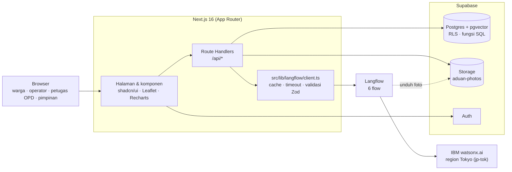

# Aduin

> **Aduin aja, sisanya kami yang urus.**

Aduin adalah "otak analitik" di balik kanal pengaduan masyarakat pemerintah daerah, dengan studi
kasus Kabupaten Probolinggo. Prototipe ini dibuat untuk Hackathon IBM.

## 1. Ringkasan

### Masalah

Banyak pemerintah daerah sudah punya kanal pengaduan berbasis WhatsApp (contoh: Halo Sae,
Kab. Probolinggo). Kanal seperti ini **reaktif**: aduan diterima, dicatat, lalu diteruskan ke
Organisasi Perangkat Daerah (OPD). Setelah itu:

- aduan tidak punya kategori dan prioritas yang konsisten, sehingga OPD yang tepat tidak selalu jelas;
- pekerjaan yang melibatkan beberapa OPD dikoordinasikan manual lewat chat atau telepon;
- tidak ada bukti bahwa masalah benar-benar selesai, dan warga tidak diminta konfirmasi;
- lonjakan masalah serupa di satu wilayah baru ketahuan setelah viral;
- pimpinan tidak punya data agregat yang bisa dipakai untuk mengambil keputusan.

### Solusi

Aduin dipasang **di atas** kanal yang sudah ada, bukan menggantikannya. Warga cukup mengadu lewat
chat. Aduin lalu:

1. men-triase aduan dengan AI dan menjelaskan alasannya;
2. mengelompokkan aduan serupa dan memetakan hotspot;
3. menyusun rencana koordinasi lintas OPD;
4. memverifikasi penyelesaian dari foto sebelum dan sesudah, lalu meminta warga mengonfirmasi;
5. mendeteksi lonjakan aduan sejak dini dan meringkasnya untuk operator dan pimpinan.

Semua AI dijalankan lewat **Langflow** dengan model **IBM watsonx.ai**. Manusia tetap memegang
keputusan akhir: operator bisa mengoreksi hasil AI, dan aduan hanya bisa ditutup oleh warga.

## 2. Fitur utama

| Fitur | Yang dilakukan | Halaman | Role |
|---|---|---|---|
| **Triage AI yang bisa dijelaskan, dengan klarifikasi** | Simulator WhatsApp. Jika aduan kurang lengkap (mis. tanpa lokasi), bot bertanya balik dulu. Aduan lengkap ditriase: kategori, OPD tujuan, urgensi 1–5, dampak, jalur penanganan, dan **alasan**. Operator bisa meng-override; koreksi tercatat. | `/lapor`, `/dashboard`, `/aduan/[id]` | warga, operator |
| **Clustering dan peta hotspot** | Aduan diubah menjadi embedding 768 dimensi (pgvector), lalu dikelompokkan jika isinya mirip (cosine ≥ 0,75), lokasinya ≤ 500 m, dan waktunya ≤ 14 hari. Peta Leaflet menampilkan marker, cluster, dan intensitas per kecamatan. | `/peta` | operator |
| **AI agent koordinasi lintas OPD** | AI menyusun sub-tugas berurutan untuk beberapa OPD beserta ketergantungannya (mis. DPU survei → BPKAD anggaran darurat → DPU perbaikan). Tugas yang bergantung baru bisa dimulai setelah tugas sebelumnya selesai. | `/aduan/[id]`, `/tugas` | operator, petugas OPD |
| **Verifikasi penyelesaian berbasis foto** | Setelah semua tugas selesai, petugas mengunggah foto bukti. Model vision membandingkan foto sebelum dan sesudah → *Terverifikasi AI* atau *Perlu Ditinjau* (operator memutuskan). Aduan baru **Selesai** setelah warga mengonfirmasi; warga juga bisa menolak. | `/tugas`, `/lapor`, `/aduan/[id]` | petugas OPD, warga, operator |
| **Early warning dan dashboard pimpinan** | Jumlah aduan 24 jam terakhir per kategori × kecamatan dibandingkan baseline 14 hari (z-score ≥ 2,0 dan minimal 3 aduan). Alert diberi ringkasan AI dan rekomendasi OPD. Dashboard pimpinan berisi KPI, tren 7/30/90 hari, sebaran kecamatan, dan peringkat kinerja OPD. | `/alert`, `/ringkasan` | operator, pimpinan |

Status aduan dikelola sebagai state machine: `pending → triaged / triage_failed → in_progress →
ai_verified / needs_review → closed`. Status `closed` hanya bisa dicapai dari `ai_verified`.

## 3. Arsitektur singkat



- **Next.js + TypeScript + Tailwind + shadcn/ui.** Semua panggilan AI lewat
  `src/lib/langflow/client.ts`: cek `ai_cache`, panggil Langflow dengan timeout, parsing tahan
  banting, lalu validasi Zod. Aplikasi **tidak** memanggil watsonx.ai langsung, dan tidak ada panggilan
  AI dari komponen client.
- **Supabase**: data dan Row Level Security, `pgvector` untuk embedding, bucket Storage
  `aduan-photos`, dan Auth untuk akun per role. Statistik early warning dihitung oleh fungsi Postgres
  `alert_window_stats`. Penggantian rencana koordinasi dilakukan atomik oleh
  `replace_coordination_plan`.
- **Langflow 1.12** menjalankan enam flow, dan semua model dipanggil di **IBM watsonx.ai region
  Tokyo**.
- **Fallback di setiap flow.** Contohnya: triage yang gagal membuat status `triage_failed`,
  verifikasi yang gagal membuat status `needs_review`, dan ringkasan alert yang gagal bisa dicoba
  ulang. Hasil AI untuk data seed disimpan di snapshot, sehingga demo tetap jalan walau Langflow
  lambat.

Dokumen rinci: [`docs/PRD.md`](docs/PRD.md), [`docs/ARCHITECTURE.md`](docs/ARCHITECTURE.md),
[`docs/LANGFLOW_FLOWS.md`](docs/LANGFLOW_FLOWS.md), [`docs/TASKS.md`](docs/TASKS.md), dan naskah
demo [`docs/DEMO_SCRIPT.md`](docs/DEMO_SCRIPT.md).

## 4. Enam flow Langflow

Semua flow menerima satu string JSON lewat **Chat Input** dan mengembalikan JSON lewat **Chat
Output**. Kontrak input/output lengkap ada di [`docs/LANGFLOW_FLOWS.md`](docs/LANGFLOW_FLOWS.md),
prompt di [`langflow/prompts/`](langflow/prompts/), dan export flow di
[`langflow/flows/`](langflow/flows/).

| Flow | Fungsi | Komponen | Model (watsonx.ai, Tokyo) | Param |
|---|---|---|---|---|
| `aduin-clarify` | Menilai apakah aduan sudah lengkap; jika belum, membuat satu pertanyaan balik | Chat Input → Prompt → IBM watsonx.ai → Chat Output | `mistralai/mistral-small-3-1-24b-instruct-2503` | temp 0.1, 1000 token |
| `aduin-triage` | Kategori, OPD, urgensi, dampak, jalur, alasan | Chat Input → Prompt → IBM watsonx.ai → Chat Output | `mistralai/mistral-small-3-1-24b-instruct-2503` | temp 0, 400 token |
| `aduin-embed` | Embedding teks aduan untuk clustering | Chat Input → IBM watsonx.ai Embeddings → custom component **Aduin Embed JSON** → Chat Output | `ibm/granite-embedding-278m-multilingual` (768 dimensi) | — |
| `aduin-opd-agent` | Rencana sub-tugas lintas OPD beserta ketergantungannya | Chat Input → Prompt Template → IBM watsonx.ai → Chat Output (tanpa komponen Agent) | `mistralai/mistral-small-3-1-24b-instruct-2503` | temp 0.1, 800 token |
| `aduin-verify` | Membandingkan foto sebelum/sesudah → `ai_verified` / `needs_review` | Chat Input → Prompt Template → custom component **Aduin Verify Vision** → Chat Output | `mistralai/mistral-small-3-1-24b-instruct-2503` (vision) | temp 0, 300 token |
| `aduin-alert-summary` | Ringkasan lonjakan aduan dan rekomendasi OPD | Chat Input → Prompt → IBM watsonx.ai → Chat Output | `mistralai/mistral-small-3-1-24b-instruct-2503` | temp 0.3, 400 token |

Endpoint watsonx.ai: `https://jp-tok.ml.cloud.ibm.com`.

**Kenapa Mistral, bukan Granite?** Model Granite untuk teks dan vision tidak tersedia di region
Tokyo pada akun watsonx.ai yang kami pakai. Karena itu, kelima flow LLM memakai
`mistral-small-3-1-24b-instruct-2503`, yang juga mendukung input gambar. Embedding tetap memakai
Granite multilingual karena aduan warga bercampur bahasa Indonesia, Jawa, dan Madura.

**Dua custom component Python:**
- **Aduin Embed JSON** mengambil `complaint_text` dari input, memanggil handle Embeddings, dan
  mengembalikan `{"embedding": [...], "model_version": "..."}`.
- **Aduin Verify Vision** mengunduh foto dari bucket `aduan-photos`, mengubahnya ke base64, lalu
  memanggil `ModelInference.chat` milik `ibm_watsonx_ai` dengan pesan multimodal. Dari jawaban
  model, komponen hanya mengambil blok `{...}` supaya code fence yang kadang ditambahkan model
  terbuang.

## 5. Peran IBM Bob dalam pengembangan

Aduin dikembangkan bersama **IBM Bob** sebagai agen pembangun. Bob dikonfigurasi lewat beberapa
file:

| File | Isi |
|---|---|
| [`.bob/custom_modes.yaml`](.bob/custom_modes.yaml) | Custom mode **Aduin Builder** (`aduin-builder`): engineer full-stack Next.js + Supabase + Langflow. Mode ini wajib membaca `AGENTS.md` dan semua `.bob/rules/` sebelum bekerja, membatasi scope pada enam fitur MVP, dan menegakkan aturan coding. |
| [`AGENTS.md`](AGENTS.md) | Konteks proyek, dokumen wajib baca, stack, dan aturan kerja: satu milestone per sesi, rencana sebelum kode, lalu build + lint → centang `docs/TASKS.md` → commit. |
| [`.bob/rules/01-project.md`](.bob/rules/01-project.md) | Ringkasan proyek, persona, scope MVP, dan hal yang di luar scope. |
| [`.bob/rules/02-coding-standards.md`](.bob/rules/02-coding-standards.md) | TypeScript strict tanpa `any`, shadcn/ui + Tailwind, teks UI Bahasa Indonesia, secret hanya di `.env.local`, serta loading/empty/error state di setiap halaman. |
| [`.bob/rules/03-langflow.md`](.bob/rules/03-langflow.md) | Semua AI lewat `client.ts`, Flow ID dari env, validasi Zod, parsing tahan banting, timeout + fallback, dan larangan mengedit `langflow/flows/` secara manual. |
| [`.bob/plans/`](.bob/plans/) | Rencana kerja Bob, mis. migrasi model ke region Tokyo (Granite → Mistral, embedding 1024 → 768 dimensi). |

`docs/TASKS.md` memisahkan setiap milestone (M0–M7) menjadi dua bagian. **"Langflow (manual di
UI)"** dikerjakan tim di Langflow. **"Kode (Bob)"** dikerjakan agen pemrograman mengikuti aturan
di atas, lengkap dengan Definition of Done. Hasilnya:

- kerangka Next.js beserta skema database dan RLS (`supabase/migrations/`);
- data seed ±150 aduan;
- klien Langflow dan skema Zod;
- semua halaman dan route API;
- dokumen kontrak flow (`docs/LANGFLOW_FLOWS.md`) dan prompt di `langflow/prompts/`.

Sebagian milestone (M3–M7) dikerjakan dengan bantuan Claude Code, memakai aturan dan dokumen yang
sama. Hal ini tercatat di trailer `Co-Authored-By` pada commit terkait.

## 6. Hasil evaluasi

Triage dievaluasi pada **30 aduan held-out**, yaitu aduan baru yang tidak ada di data seed
([`supabase/seed/eval/heldout.json`](supabase/seed/eval/heldout.json)). Aduan ini ditulis dalam
bahasa Indonesia informal, Jawa, dan Madura, mencakup ketujuh kategori, dan 5 di antaranya
sengaja dibuat ambigu. Flow dipanggil **tanpa cache**.

| Ukuran | Hasil |
|---|---|
| Akurasi kategori total | **90%** (27/30) |
| Tanpa 5 kasus ambigu | **96%** (24/25) |
| Bahasa Jawa | **7/7** |
| Bahasa Madura | **7/7** |
| Bahasa Indonesia informal | 13/16 |

Target PRD adalah ≥ 80%. Akurasi pada 150 data seed lebih tinggi, tetapi angka itu kurang bisa
dipercaya karena prompt disetel dengan data tersebut. Karena itu, angka held-out di atas yang kami
jadikan acuan.

## 7. Cara menjalankan

### Prasyarat

| Kebutuhan | Keterangan |
|---|---|
| Node.js 20+ dan npm | Next.js 16 |
| Proyek Supabase | Postgres dengan ekstensi `vector` |
| Python 3.10+ dan Langflow 1.12 | `pip install langflow` lalu `langflow run` (port 7860), atau Docker |
| Akun IBM watsonx.ai | API key dan Project ID dengan akses region Tokyo (`jp-tok`) |

### 7.1 Supabase dan migrasi

1. Buat proyek Supabase, lalu catat URL, anon key, dan service role key (Project Settings → API).
2. Terapkan migrasi **berurutan** di SQL Editor (atau `supabase db push`):

   | File | Isi |
   |---|---|
   | `supabase/migrations/0001_init.sql` | Semua tabel, pgvector, RLS, trigger profil |
   | `supabase/migrations/0002_storage.sql` | Bucket `aduan-photos` (publik baca, login tulis) |
   | `supabase/migrations/0003_coordination_rpc.sql` | `replace_coordination_plan` (ganti rencana OPD secara atomik) |
   | `supabase/migrations/0004_early_warning.sql` | `alert_window_stats` (z-score) dan `shift_seed_timeline` |

### 7.2 Langflow

Panduan lengkap ada di [`langflow/README.md`](langflow/README.md).

1. Jalankan `langflow run`, lalu buka `http://localhost:7860`.
2. **Global Variables** (Settings → Global Variables): buat `WATSONX_API_KEY` (tipe Credential) dan
   `WATSONX_PROJECT_ID` (tipe Generic).
3. **Import enam flow** dari `langflow/flows/` (New Flow → Import):
   - `aduin-clarify.json`
   - `aduin-triage.json`
   - `aduin-embed.json`
   - `aduin-opd-agent.json`
   - `aduin-verify.json`
   - `aduin-alert-summary.json`
4. **Hubungkan ulang kredensial.** Global Variables tidak ikut ter-export, jadi pilih ulang
   `WATSONX_API_KEY` / `WATSONX_PROJECT_ID` di setiap komponen IBM watsonx.ai, IBM watsonx.ai
   Embeddings, dan custom component **Aduin Verify Vision**. Pastikan endpoint-nya
   `https://jp-tok.ml.cloud.ibm.com`.
5. **Custom component** sudah ikut di dalam file flow. Kode lengkapnya, untuk dibuat ulang lewat
   *New Custom Component*, ada di `docs/LANGFLOW_FLOWS.md` §Flow 3 dan §Flow 5. Jangan pakai fitur
   *Model Providers*; pakai komponen IBM watsonx.ai dari bundle IBM.
6. Uji tiap flow di Playground memakai test case di `docs/LANGFLOW_FLOWS.md`.
7. Buat API key Langflow (Settings → API Keys) dan catat **Flow ID** tiap flow (UUID di URL editor
   flow). Import membuat UUID baru, jadi selalu ambil ID dari Langflow kamu sendiri.

### 7.3 `.env.local`

Salin `.env.example` menjadi `.env.local`, lalu isi. Semua nilai di bawah adalah placeholder.
Jangan commit `.env.local`.

```dotenv
# Supabase
NEXT_PUBLIC_SUPABASE_URL=https://<project>.supabase.co
NEXT_PUBLIC_SUPABASE_ANON_KEY=<anon-key>
SUPABASE_SERVICE_ROLE_KEY=<service-role-key>

# Langflow
LANGFLOW_BASE_URL=http://127.0.0.1:7860
LANGFLOW_API_KEY=<langflow-api-key>
LANGFLOW_FLOW_CLARIFY_ID=<uuid>
LANGFLOW_FLOW_TRIAGE_ID=<uuid>
LANGFLOW_FLOW_EMBED_ID=<uuid>
LANGFLOW_FLOW_OPD_AGENT_ID=<uuid>
LANGFLOW_FLOW_VERIFY_ID=<uuid>
LANGFLOW_FLOW_ALERT_SUMMARY_ID=<uuid>

# Embedding & clustering
EMBEDDING_DIMENSION=768
CLUSTER_SIMILARITY_THRESHOLD=0.75
CLUSTER_RADIUS_METERS=500
CLUSTER_WINDOW_DAYS=14

# Early warning
ALERT_THRESHOLD_Z=2.0
ALERT_MIN_COUNT=3
LANGFLOW_ALERT_TIMEOUT_MS=10000

# Mode demo
NEXT_PUBLIC_DEMO_MODE=true
DEMO_SEED_PASSWORD=<kata-sandi-akun-demo>
```

- `NEXT_PUBLIC_DEMO_MODE=true` mengaktifkan tiga hal: tombol masuk per role di landing page,
  RoleSwitcher di header, dan tombol Reset Demo. Wajib `false` di production.
- `DEMO_SEED_PASSWORD` hanya dibaca server, jadi jangan pernah dijadikan variabel `NEXT_PUBLIC_*`.
  Hindari karakter `$` di dalamnya (lihat Troubleshooting).
- Kredensial watsonx.ai **tidak** disimpan di `.env.local`. Kredensial itu hanya ada di Global
  Variables Langflow.

### 7.4 Instal dan isi data

```bash
npm install
npx tsx --env-file=.env.local supabase/seed/index.ts
npm run dev        # http://localhost:3000
```

`supabase/seed/index.ts` membangun keadaan demo lengkap **tanpa memanggil Langflow**:

- wilayah (5 kecamatan dan desanya) dan 7 OPD;
- 6 akun demo;
- ±150 aduan seed;
- hasil AI dari `supabase/seed/ai-cache-snapshot.json` (triage, embedding, isi `ai_cache`);
- rencana koordinasi sederhana dan clustering;
- timeline yang digeser ke waktu sekarang, lalu deteksi early warning, sehingga alert diare
  Sumberasih terbentuk.

⚠️ Script ini menghapus semua aduan (termasuk aduan latihan), alert, dan cluster sebelum
membangun ulang. Akun demo tidak dihapus.

Script lain dijalankan dengan `npx tsx --env-file=.env.local <script>`:

| Urutan | Script | Kapan dipakai |
|---|---|---|
| — | `supabase/seed/index.ts` | Seed utama (di atas). |
| — | `supabase/seed/refresh-demo-timeline.ts` | **Sebelum demo.** Menggeser timeline seed agar aduan diare Sumberasih terbaru ±2 jam lalu, lalu menjalankan early warning. Aman diulang. |
| 1 | `supabase/seed/triage-seed.ts` | Membuat ulang hasil triage seed lewat Langflow (mis. setelah prompt berubah). |
| 2 | `supabase/seed/embed-seed.ts` | Membuat embedding yang belum ada lewat Langflow, lalu clustering ulang. |
| 3 | `supabase/seed/precompute-ai.ts` | Mengekspor hasil AI dari database ke `ai-cache-snapshot.json` (tanpa Langflow) dan mencetak akurasi triage seed. Commit file hasilnya. |
| — | `supabase/seed/fix-coordinates.ts` | Memperbarui koordinat di database lama ke tata letak terbaru tanpa menghapus hasil AI. |
| — | `supabase/seed/eval-triage.ts` | Evaluasi held-out (lihat 7.6). |

Untuk memperbarui snapshot AI, jalankan urutan 1 → 2 → 3, lalu commit `ai-cache-snapshot.json`.

**Akun demo.** Semua akun memakai password `DEMO_SEED_PASSWORD`. Saat mode demo aktif, masuk lewat
tombol di landing page `/` atau RoleSwitcher di header.

| Email | Role | Halaman utama |
|---|---|---|
| `warga@demo.aduin` | warga | `/lapor` |
| `operator@demo.aduin` | operator | `/dashboard` |
| `pu@demo.aduin` | petugas OPD (DPU) | `/tugas` |
| `dinkes@demo.aduin` | petugas OPD (Dinkes) | `/tugas` |
| `bpkad@demo.aduin` | petugas OPD (BPKAD) | `/tugas` |
| `pimpinan@demo.aduin` | pimpinan | `/ringkasan` |

### 7.5 Reset Demo

Ada dua cara:

- **Dari aplikasi:** masuk sebagai operator → `/dashboard` → **Reset Demo** → konfirmasi (±1 menit).
  Aduan seed dan hasil AI dipulihkan dari snapshot, aduan latihan dihapus, timeline digeser, dan
  early warning dijalankan. Pesan hasilnya menyebut apakah alert diare Sumberasih aktif. Tombol ini
  hanya untuk operator dan hanya muncul jika `NEXT_PUBLIC_DEMO_MODE=true`.
- **Dari terminal:** `npx tsx --env-file=.env.local supabase/seed/index.ts`.

Naskah demo dan checklist persiapan ada di [`docs/DEMO_SCRIPT.md`](docs/DEMO_SCRIPT.md).

### 7.6 Menjalankan evaluasi

Pastikan Langflow menyala dan `LANGFLOW_FLOW_TRIAGE_ID` sudah benar, lalu jalankan:

```bash
npx tsx --env-file=.env.local supabase/seed/eval-triage.ts
```

Script ini mengirim 30 aduan held-out ke `aduin-triage` tanpa cache dan tanpa menulis ke database.
Hasilnya berupa akurasi total, akurasi per kategori dan per bahasa, serta daftar aduan yang tidak
cocok.

### Perintah pengembangan

```bash
npm run dev     # server pengembangan
npm run build   # build produksi (termasuk cek TypeScript)
npm run lint    # ESLint
```

## 8. Troubleshooting

Masalah yang pernah kami temui:

| Gejala | Penyebab | Solusi |
|---|---|---|
| Script seed gagal: URL Supabase / key kosong, atau `DEMO_SEED_PASSWORD` tidak terbaca | `npx tsx` tidak membaca `.env.local`. Script memakai `dotenv/config`, yang hanya membaca `.env`. | Selalu jalankan dengan `npx tsx --env-file=.env.local <script>`. |
| Aplikasi dibuka lewat alamat IP (mis. `http://192.168.x.x:3000`): halaman tampil tapi tombol tidak berfungsi, dan terminal menulis *Blocked cross-origin request … allowedDevOrigins* | Server dev Next.js memblokir permintaan ke aset `/_next/*` dari origin selain `localhost`. | Buka lewat `http://localhost:3000`. Jika harus lewat IP (mis. dari HP), tambahkan `allowedDevOrigins: ["192.168.x.x"]` di `next.config.ts`, atau pakai `npm run build && npm run start`. |
| Model Granite tidak muncul atau gagal dipanggil, atau Langflow terus memvalidasi `granite-4-h-small` | Model Granite teks dan vision tidak tersedia di region Tokyo pada akun kami. Fitur *Model Providers* Langflow juga selalu memvalidasi model Granite. | Pakai `mistralai/mistral-small-3-1-24b-instruct-2503` untuk LLM dan vision, serta `ibm/granite-embedding-278m-multilingual` untuk embedding, dengan endpoint `https://jp-tok.ml.cloud.ibm.com`. Pakai komponen IBM watsonx.ai langsung, jangan *Model Providers*, dan jangan komponen *Agent*. |
| Komponen Prompt Langflow menolak template: **"unclosed tag"** | `{nama}` dianggap variabel. Kurung kurawal literal harus `{{ }}` dan setiap `{{` harus berpasangan dengan `}}`. Kalimat seperti "Awali jawaban dengan karakter {{" memicu error ini. | Escape contoh JSON menjadi `{{ … }}`, dan tulis instruksi penutup dengan kata-kata: "Karakter pertama jawabanmu harus kurung kurawal buka…". Lihat `langflow/README.md`. |
| Login akun demo gagal ("Invalid login credentials"), padahal seed sukses | Ada karakter `$` di nilai `.env.local`, mis. `DEMO_SEED_PASSWORD`. Next.js mengekspansi `$NAMA` sebagai variabel (jadi kosong atau terpotong), sedangkan `tsx --env-file` membaca nilainya apa adanya. Akibatnya password di seed berbeda dari password di aplikasi. | Pakai password tanpa `$`. Setelah mengganti, jalankan ulang seed agar password akun disinkronkan. |
| Triage selalu `triage_failed` | Langflow mati atau Flow ID salah. | Cek `curl http://localhost:7860/health` dan `LANGFLOW_FLOW_TRIAGE_ID`. |
| `401 Unauthorized` dari Langflow | `LANGFLOW_API_KEY` salah. | Buat ulang API key di Langflow. |
| Alert diare Sumberasih tidak muncul | Timeline seed sudah lewat 24 jam. | Jalankan `refresh-demo-timeline.ts`, atau Reset Demo. |
| Alert tampil tanpa ringkasan ("Ringkasan AI belum tersedia") | Langflow gagal atau timeout saat alert dibuat. | Nyalakan Langflow, lalu klik **Coba Lagi** di `/alert`. |
| Verifikasi foto selalu "Perlu Ditinjau" dengan alasan "Verifikasi AI gagal" | Flow `aduin-verify` gagal. | Cek kredensial Aduin Verify Vision, pastikan bucket `aduan-photos` publik, dan pastikan Langflow menyala. |
| Error "Terapkan migrasi …0003/0004…" | Migrasi belum diterapkan. | Jalankan file SQL yang disebut. |
