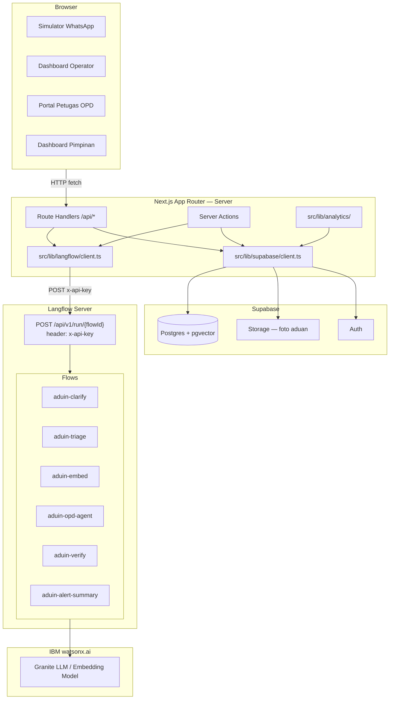
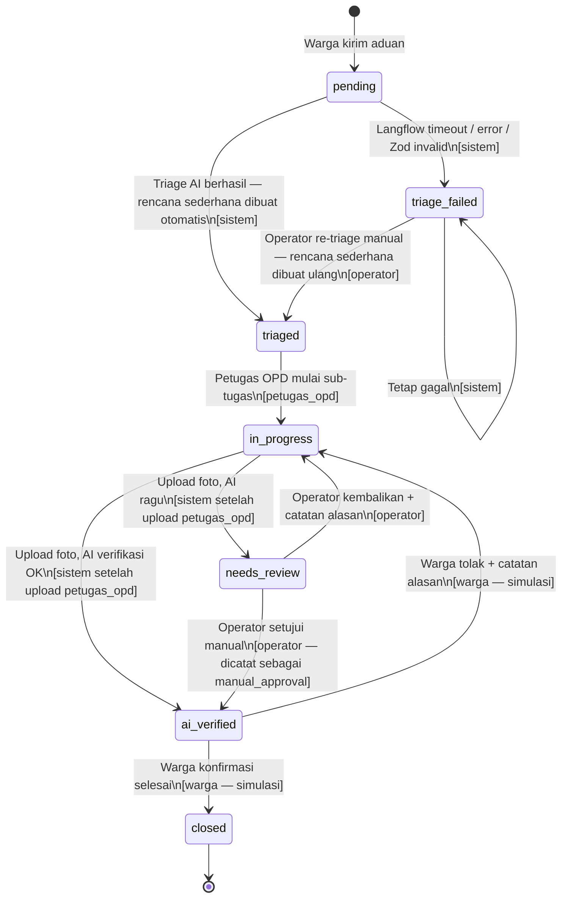

# ARCHITECTURE — Aduin

> Dokumen referensi teknis untuk implementasi. Dibaca sebelum menulis kode apapun.

---

## 1. Diagram Arsitektur



Semua panggilan ke Langflow **hanya** dari `src/lib/langflow/client.ts` di sisi server. Komponen client tidak boleh memanggil Langflow secara langsung.

---

## 2. Struktur Folder

```
aduin/
├── .bob/
│   └── rules/                  # Aturan kerja per-workspace (project, coding, langflow)
├── docs/
│   ├── PRD.md
│   ├── ARCHITECTURE.md         # File ini
│   ├── LANGFLOW_FLOWS.md       # Kontrak input/output setiap flow
│   └── TASKS.md                # Checklist milestone
├── langflow/
│   ├── flows/                  # Export JSON dari Langflow — JANGAN edit manual
│   └── prompts/                # Prompt template yang dirujuk flow
├── supabase/
│   ├── migrations/             # File SQL migrasi berurutan
│   └── seed/                   # Script seed data demo (±150 aduan)
└── src/
    ├── app/                    # Next.js App Router
    │   ├── (warga)/
    │   │   └── lapor/          # Simulator WhatsApp
    │   ├── (operator)/
    │   │   ├── dashboard/      # Daftar aduan + triage
    │   │   ├── peta/           # Peta hotspot + clustering
    │   │   └── alert/          # Early warning panel
    │   ├── (opd)/
    │   │   └── tugas/          # Portal tugas petugas OPD
    │   ├── (pimpinan)/
    │   │   └── ringkasan/      # Dashboard KPI pimpinan
    │   └── api/
    │       ├── complaints/     # CRUD aduan
    │       ├── triage/         # Trigger triage AI
    │       ├── cluster/        # Trigger clustering
    │       ├── verify/         # Upload foto + verifikasi AI
    │       ├── alert/          # Early warning check + dismiss
    │       └── coordination/   # Rencana koordinasi OPD
    ├── components/             # shadcn/ui + komponen kustom
    ├── lib/
    │   ├── langflow/
    │   │   ├── client.ts       # Satu-satunya titik panggil Langflow
    │   │   ├── flows.ts        # Peta flow ID dari env variables
    │   │   └── schemas.ts      # Validasi Zod output setiap flow
    │   ├── supabase/
    │   │   ├── client.ts       # Supabase client (server-side)
    │   │   └── types.ts        # Generated types dari skema DB
    │   ├── analytics/
    │   │   ├── clustering.ts   # Algoritma clustering
    │   │   └── early-warning.ts# Algoritma z-score early warning
    │   └── constants/
    │       └── categories.ts   # Daftar kategori baku + pemetaan default ke OPD
    └── types/                  # TypeScript global types
```

---

## 3. State Machine Status Aduan



### Siapa yang boleh memicu tiap transisi

| Transisi | Pemicu | Catatan |
|---|---|---|
| `pending` → `triaged` | Sistem (otomatis setelah aduan masuk) | Dipicu route handler `POST /api/triage`; setelah berhasil, sistem langsung membuat `coordination_plan` sederhana (1 task ke `effective_opd_id`) |
| `pending` → `triage_failed` | Sistem (Langflow error/timeout/Zod invalid) | Log error di server |
| `triage_failed` → `triaged` | Operator (re-triage manual via UI) | Rencana sederhana dibuat ulang setelah re-triage berhasil |
| `triaged` → `in_progress` | Petugas OPD (mulai kerjakan sub-tugas) | — |
| `in_progress` → `ai_verified` | Sistem (setelah petugas upload foto, AI OK) | — |
| `in_progress` → `needs_review` | Sistem (setelah petugas upload foto, AI ragu) | — |
| `needs_review` → `ai_verified` | Operator (persetujuan manual, dicatat `manual_approval`) | — |
| `needs_review` → `in_progress` | Operator (kembalikan + catatan alasan) | — |
| `ai_verified` → `closed` | Warga simulasi (konfirmasi selesai) | — |
| `ai_verified` → `in_progress` | Warga simulasi (tolak + catatan alasan) | — |

### Rencana Koordinasi: Sederhana vs Multi-OPD

Setelah triage berhasil, sistem otomatis membuat satu `coordination_plan` sederhana berisi **satu task** yang ditugaskan ke `effective_opd_id`. Ini memastikan petugas OPD langsung bisa melihat tugasnya tanpa menunggu operator.

Jika operator menekan **"Buat Rencana Koordinasi"** pada aduan yang sudah di-triage, flow `aduin-opd-agent` dijalankan dan hasilnya **menggantikan** rencana sederhana tersebut (DELETE plan lama + tasks lama, INSERT plan baru + tasks + dependencies). Penggantian ini dicatat di kolom `coordination_plans.plan_type`.

---

## 4. Skema Database

> Semua tabel memakai `id uuid DEFAULT gen_random_uuid() PRIMARY KEY` kecuali disebutkan lain.

### 4.1 `regions`
Wilayah administratif (kecamatan / desa).

| Kolom | Tipe | Keterangan |
|---|---|---|
| `id` | `uuid` PK | — |
| `name` | `text NOT NULL` | Nama desa/kecamatan |
| `level` | `text NOT NULL` | `'kecamatan'` atau `'desa'` |
| `parent_id` | `uuid` FK → `regions.id` | Null untuk kecamatan |
| `lat` | `double precision` | Koordinat pusat |
| `lng` | `double precision` | Koordinat pusat |
| `created_at` | `timestamptz DEFAULT now()` | — |

**Index:** `(level)`, `(parent_id)`

---

### 4.2 `opd`
Organisasi Perangkat Daerah.

| Kolom | Tipe | Keterangan |
|---|---|---|
| `id` | `uuid` PK | — |
| `name` | `text NOT NULL UNIQUE` | Contoh: "Dinas PU", "Dinas Kesehatan" |
| `short_name` | `text NOT NULL` | Contoh: "DPU", "Dinkes" |
| `contact_info` | `jsonb` | Telepon, email |
| `created_at` | `timestamptz DEFAULT now()` | — |

---

### 4.3 `complaints`
Tabel utama aduan.

| Kolom | Tipe | Keterangan |
|---|---|---|
| `id` | `uuid` PK | — |
| `text` | `text NOT NULL` | Teks aduan asli dari warga |
| `status` | `text NOT NULL DEFAULT 'pending'` | Lihat state machine §3 |
| `region_id` | `uuid` FK → `regions.id` | Desa pelaporan |
| `lat` | `double precision` | Koordinat pin |
| `lng` | `double precision` | Koordinat pin |
| `photo_before_url` | `text` | URL foto sebelum di Supabase Storage |
| `photo_after_url` | `text` | URL foto sesudah di Supabase Storage |
| `reporter_id` | `uuid` FK → `auth.users.id` | Warga pelapor (null jika simulasi) |
| `reported_at` | `timestamptz NOT NULL DEFAULT now()` | Waktu aduan masuk |
| `closed_at` | `timestamptz` | Diisi saat `closed` |
| `label_manual` | `text` | Kategori ground-truth (untuk evaluasi akurasi triage, memakai slug dari §4.17) |
| `is_seed` | `boolean NOT NULL DEFAULT false` | Penanda data seed demo |
| `cluster_id` | `uuid` FK → `clusters.id` | Null sebelum di-cluster |
| `effective_category` | `text` | Slug kategori aktif — diisi dari `triage_results.category` saat triage berhasil, diperbarui jika ada `triage_overrides` untuk field `'category'` |
| `effective_opd_id` | `uuid` FK → `opd.id` | OPD aktif — diisi dari `triage_results.opd_id`, diperbarui jika ada override `'opd'` |
| `created_at` | `timestamptz DEFAULT now()` | — |
| `updated_at` | `timestamptz DEFAULT now()` | — |

**Index:** `(status)`, `(region_id)`, `(cluster_id)`, `(reported_at)`, `(is_seed)`, `(label_manual)`, `(effective_category)`, `(effective_opd_id)`

> `effective_category` dan `effective_opd_id` adalah **sumber kebenaran tunggal** untuk semua query:
> - Early warning §5.2 memakai `effective_category`
> - Clustering §5.1 memakai `effective_category` sebagai label cluster
> - Dashboard analytics (§7) memakai `effective_category` untuk agregasi
> - RLS `petugas_opd` memakai `effective_opd_id` untuk memfilter aduan yang boleh dilihat

---

### 4.4 `complaint_embeddings`
Vektor embedding teks aduan (pgvector).

| Kolom | Tipe | Keterangan |
|---|---|---|
| `id` | `uuid` PK | — |
| `complaint_id` | `uuid` NOT NULL FK → `complaints.id` UNIQUE | — |
| `embedding` | `vector($EMBEDDING_DIMENSION)` | Output `aduin-embed` flow; dimensi mengikuti env `EMBEDDING_DIMENSION` |
| `model_version` | `text NOT NULL` | Versi model embedding (`ibm/granite-embedding-278m-multilingual`) |
| `created_at` | `timestamptz DEFAULT now()` | — |

**Index:** `(complaint_id)`, ivfflat/hnsw index pada `embedding vector_cosine_ops`

> **Model:** `ibm/granite-embedding-278m-multilingual` (768 dimensi) — model **multilingual**, karena teks aduan warga mengandung campuran Bahasa Indonesia dan bahasa daerah (Jawa/Madura). Dimensi dicatat di `EMBEDDING_DIMENSION` dan harus konsisten dengan kolom `vector(768)`, `embedOutputSchema`, dan script seed.

---

### 4.5 `clusters`
Grup aduan yang tercluster.

| Kolom | Tipe | Keterangan |
|---|---|---|
| `id` | `uuid` PK | — |
| `label` | `text` | Label deskriptif cluster (dihasilkan dari kategori dominan) |
| `category` | `text` | Kategori dominan anggota cluster |
| `region_id` | `uuid` FK → `regions.id` | Wilayah dominan cluster |
| `centroid_lat` | `double precision` | Rata-rata lat anggota |
| `centroid_lng` | `double precision` | Rata-rata lng anggota |
| `member_count` | `integer NOT NULL DEFAULT 0` | Jumlah aduan anggota |
| `first_seen_at` | `timestamptz` | Waktu aduan pertama di cluster ini |
| `last_seen_at` | `timestamptz` | Waktu aduan terbaru di cluster ini |
| `created_at` | `timestamptz DEFAULT now()` | — |
| `updated_at` | `timestamptz DEFAULT now()` | — |

**Index:** `(region_id)`, `(category)`, `(last_seen_at)`

---

### 4.6 `triage_results`
Hasil triage AI per aduan.

| Kolom | Tipe | Keterangan |
|---|---|---|
| `id` | `uuid` PK | — |
| `complaint_id` | `uuid` NOT NULL FK → `complaints.id` | — |
| `category` | `text NOT NULL` | Kategori masalah |
| `opd_id` | `uuid` FK → `opd.id` | OPD yang dituju |
| `urgency` | `smallint NOT NULL` | 1–5 |
| `impact` | `text NOT NULL` | `'rendah'`, `'sedang'`, `'tinggi'` |
| `handling_path` | `text NOT NULL` | `'quick_fix'`, `'bertahap'`, `'butuh_data'` |
| `reason` | `text NOT NULL` | Alasan AI dalam Bahasa Indonesia |
| `raw_response` | `jsonb` | Respons mentah Langflow (untuk debugging) |
| `from_cache` | `boolean NOT NULL DEFAULT false` | Apakah dari cache |
| `created_at` | `timestamptz DEFAULT now()` | — |

**Index:** `(complaint_id)`, `(opd_id)`, `(category)`

---

### 4.7 `triage_overrides`
Koreksi manual operator terhadap hasil triage AI.

| Kolom | Tipe | Keterangan |
|---|---|---|
| `id` | `uuid` PK | — |
| `complaint_id` | `uuid` NOT NULL FK → `complaints.id` | — |
| `operator_id` | `uuid` NOT NULL FK → `auth.users.id` | — |
| `field_overridden` | `text NOT NULL` | `'category'`, `'opd'`, atau `'handling_path'` |
| `old_value` | `text NOT NULL` | Nilai sebelum override |
| `new_value` | `text NOT NULL` | Nilai setelah override |
| `note` | `text` | Alasan override (opsional) |
| `created_at` | `timestamptz DEFAULT now()` | — |

**Index:** `(complaint_id)`, `(operator_id)`

---

### 4.8 `coordination_plans`
Rencana koordinasi lintas OPD per aduan.

| Kolom | Tipe | Keterangan |
|---|---|---|
| `id` | `uuid` PK | — |
| `complaint_id` | `uuid` NOT NULL FK → `complaints.id` UNIQUE | — |
| `plan_type` | `text NOT NULL DEFAULT 'simple'` | `'simple'` = dibuat otomatis pasca triage; `'ai_generated'` = diganti oleh `aduin-opd-agent` |
| `summary` | `text` | Ringkasan rencana |
| `raw_response` | `jsonb` | Respons mentah `aduin-opd-agent` (null untuk rencana sederhana) |
| `created_by` | `uuid` FK → `auth.users.id` | Operator yang memicu (null untuk rencana sederhana) |
| `created_at` | `timestamptz DEFAULT now()` | — |

**Index:** `(complaint_id)`, `(plan_type)`

> Rencana sederhana dibuat oleh sistem (service role) saat `POST /api/triage/[id]` berhasil. Rencana `ai_generated` menggantikan rencana sederhana: plan lama + tasks lama dihapus, plan baru + tasks + dependencies diinsert dalam satu transaksi.

---

### 4.9 `tasks`
Sub-tugas dari rencana koordinasi.

| Kolom | Tipe | Keterangan |
|---|---|---|
| `id` | `uuid` PK | — |
| `plan_id` | `uuid` NOT NULL FK → `coordination_plans.id` | — |
| `opd_id` | `uuid` NOT NULL FK → `opd.id` | OPD penanggung jawab |
| `title` | `text NOT NULL` | Judul sub-tugas |
| `description` | `text` | Detail sub-tugas |
| `status` | `text NOT NULL DEFAULT 'belum_mulai'` | `'belum_mulai'`, `'proses'`, `'selesai'` |
| `sequence` | `smallint NOT NULL` | Urutan eksekusi |
| `completed_at` | `timestamptz` | — |
| `created_at` | `timestamptz DEFAULT now()` | — |
| `updated_at` | `timestamptz DEFAULT now()` | — |

**Index:** `(plan_id)`, `(opd_id)`, `(status)`

---

### 4.10 `task_dependencies`
Ketergantungan antar sub-tugas (task sebelumnya harus selesai dahulu).

| Kolom | Tipe | Keterangan |
|---|---|---|
| `task_id` | `uuid` NOT NULL FK → `tasks.id` | Task yang bergantung |
| `depends_on_task_id` | `uuid` NOT NULL FK → `tasks.id` | Task yang harus selesai dahulu |
| `created_at` | `timestamptz DEFAULT now()` | — |

**PK:** `(task_id, depends_on_task_id)`

---

### 4.11 `verifications`
Hasil verifikasi AI atas foto penyelesaian.

| Kolom | Tipe | Keterangan |
|---|---|---|
| `id` | `uuid` PK | — |
| `complaint_id` | `uuid` NOT NULL FK → `complaints.id` | — |
| `photo_after_url` | `text NOT NULL` | URL foto sesudah |
| `ai_status` | `text NOT NULL` | `'ai_verified'` atau `'needs_review'` |
| `ai_reason` | `text NOT NULL` | Alasan verifikasi AI |
| `manual_approval` | `boolean` | Null = belum diproses, true = disetujui operator |
| `approved_by` | `uuid` FK → `auth.users.id` | Operator yang menyetujui (jika manual) |
| `approval_note` | `text` | Catatan operator |
| `raw_response` | `jsonb` | Respons mentah `aduin-verify` |
| `from_cache` | `boolean NOT NULL DEFAULT false` | — |
| `created_at` | `timestamptz DEFAULT now()` | — |

**Index:** `(complaint_id)`, `(ai_status)`

---

### 4.12 `citizen_confirmations`
Konfirmasi atau penolakan warga atas verifikasi.

| Kolom | Tipe | Keterangan |
|---|---|---|
| `id` | `uuid` PK | — |
| `complaint_id` | `uuid` NOT NULL FK → `complaints.id` | — |
| `confirmed` | `boolean NOT NULL` | `true` = konfirmasi selesai, `false` = tolak |
| `note` | `text` | Alasan penolakan (jika `confirmed = false`) |
| `confirmed_at` | `timestamptz NOT NULL DEFAULT now()` | — |

**Index:** `(complaint_id)`

---

### 4.13 `alerts`
Peringatan dini lonjakan aduan.

| Kolom | Tipe | Keterangan |
|---|---|---|
| `id` | `uuid` PK | — |
| `category` | `text NOT NULL` | Slug kategori masalah yang melonjak (dari `CATEGORIES`) |
| `region_id` | `uuid` FK → `regions.id` | Wilayah lonjakan |
| `count_24h` | `integer NOT NULL` | Jumlah aduan 24 jam terakhir |
| `mean_14d` | `double precision NOT NULL` | Rata-rata harian 14 hari (baseline) |
| `std_14d` | `double precision NOT NULL` | Standar deviasi baseline |
| `z_score` | `double precision NOT NULL` | Z-score yang memicu alert |
| `ai_summary` | `text` | Ringkasan AI dari `aduin-alert-summary` (null jika belum diisi) |
| `ai_recommendations` | `jsonb` | Array nama OPD yang direkomendasikan (null jika belum diisi) |
| `summary_status` | `text NOT NULL DEFAULT 'pending_retry'` | `'done'` = ringkasan AI tersedia; `'pending_retry'` = belum / gagal |
| `is_seed` | `boolean NOT NULL DEFAULT false` | Penanda alert dari data seed |
| `triggered_at` | `timestamptz NOT NULL DEFAULT now()` | — |
| `created_at` | `timestamptz DEFAULT now()` | — |

**Index:** `(region_id)`, `(category)`, `(triggered_at)`, `(is_seed)`, `(summary_status)`

---

### 4.14 `alert_dismissals`
Log penutupan alert oleh operator.

| Kolom | Tipe | Keterangan |
|---|---|---|
| `id` | `uuid` PK | — |
| `alert_id` | `uuid` NOT NULL FK → `alerts.id` UNIQUE | — |
| `operator_id` | `uuid` NOT NULL FK → `auth.users.id` | — |
| `note` | `text` | Alasan dismiss |
| `dismissed_at` | `timestamptz NOT NULL DEFAULT now()` | — |

**Index:** `(alert_id)`, `(operator_id)`

---

### 4.15 `ai_cache`
Cache hasil AI untuk aduan seed agar demo tidak bergantung Langflow real-time.

| Kolom | Tipe | Keterangan |
|---|---|---|
| `id` | `uuid` PK | — |
| `flow_name` | `text NOT NULL` | Nama flow Langflow (`aduin-triage`, dst.) |
| `input_hash` | `text NOT NULL` | SHA-256 dari input (teks + konteks relevan) |
| `output` | `jsonb NOT NULL` | Hasil flow yang valid (sudah lulus Zod) |
| `complaint_id` | `uuid` FK → `complaints.id` | Null untuk cache non-aduan-spesifik |
| `created_at` | `timestamptz DEFAULT now()` | — |
| `expires_at` | `timestamptz` | Null = tidak pernah expired |

**Unique constraint:** `(flow_name, input_hash)`
**Index:** `(flow_name, input_hash)`, `(complaint_id)`

---

### 4.16 `users` / Roles

Aduin menggunakan **Supabase Auth** (`auth.users`). Tabel profil kustom:

```sql
CREATE TABLE public.profiles (
  id          uuid PRIMARY KEY REFERENCES auth.users(id) ON DELETE CASCADE,
  full_name   text,
  role        text NOT NULL DEFAULT 'warga',
  opd_id      uuid REFERENCES opd(id),   -- hanya untuk petugas_opd
  is_demo     boolean NOT NULL DEFAULT false, -- akun demo dari script seed
  created_at  timestamptz DEFAULT now()
);
```

**Nilai `role`:** `'warga'`, `'operator'`, `'petugas_opd'`, `'pimpinan'`

---

### 4.17 Kategori Baku

Sumber kebenaran tunggal untuk semua nilai kategori di seluruh sistem. Disimpan sebagai **konstanta TypeScript** di [`src/lib/constants/categories.ts`](src/lib/constants/categories.ts) (bukan tabel DB) agar tersedia di client dan server tanpa query.

```typescript
// src/lib/constants/categories.ts
export const CATEGORIES = [
  { slug: 'infrastruktur_jalan',   label: 'Infrastruktur Jalan',        defaultOpdShortName: 'DPU'      },
  { slug: 'kesehatan_diare',       label: 'Kesehatan & Sanitasi',       defaultOpdShortName: 'Dinkes'  },
  { slug: 'pengelolaan_sampah',    label: 'Pengelolaan Sampah',          defaultOpdShortName: 'DLH'     },
  { slug: 'banjir_drainase',       label: 'Banjir/Drainase',             defaultOpdShortName: 'DPU'     },
  { slug: 'air_bersih_pdam',       label: 'Air Bersih/PDAM',             defaultOpdShortName: 'PDAM'    },
  { slug: 'pendidikan',            label: 'Pendidikan',                  defaultOpdShortName: 'Disdik'  },
  { slug: 'pkl_tata_ruang',        label: 'PKL/Tata Ruang',              defaultOpdShortName: 'Satpol'  },
] as const;

export type CategorySlug = typeof CATEGORIES[number]['slug'];
```

**Aturan penggunaan:**
- Semua kolom `category` / `effective_category` / `label_manual` di database menyimpan nilai **slug** (contoh: `'infrastruktur_jalan'`)
- Flow `aduin-triage` **wajib** memilih slug dari daftar ini; jika output tidak cocok dengan slug yang valid, Zod validation di `schemas.ts` menolak hasilnya
- Pemetaan `defaultOpdShortName` digunakan oleh rencana koordinasi sederhana (pasca-triage) untuk menentukan OPD awal; OPD final diambil dari `opd.short_name` yang cocok
- Label tampilan di UI diambil dari `CATEGORIES.find(c => c.slug === slug).label`

---

## 5. Algoritma Clustering dan Early Warning

### 5.1 Clustering

Dijalankan di **Next.js route handler / SQL** — bukan di Langflow.

**Tiga syarat sekaligus untuk aduan masuk cluster yang sama:**
1. **Cosine similarity** antara embedding aduan ≥ `CLUSTER_SIMILARITY_THRESHOLD` (default: `0.75`)
2. **Jarak haversine** antar aduan ≤ `CLUSTER_RADIUS_METERS` (default: `500`)
3. **Selisih waktu** `reported_at` ≤ `CLUSTER_WINDOW_DAYS` (default: `14`) hari

**Rumus Haversine (dalam meter):**
```
R = 6371000
Δlat = (lat2 - lat1) * π/180
Δlng = (lng2 - lng1) * π/180
a = sin²(Δlat/2) + cos(lat1*π/180) * cos(lat2*π/180) * sin²(Δlng/2)
d = 2R * asin(√a)
```

**Pseudocode:**
```
function runClustering(newComplaint):
  embedding = getEmbedding(newComplaint.id)            // dari complaint_embeddings
  candidates = queryDB("""
    SELECT c.*, ce.embedding
    FROM complaints c
    JOIN complaint_embeddings ce ON ce.complaint_id = c.id
    WHERE c.reported_at >= now() - INTERVAL '14 days'
      AND c.id != newComplaint.id
      AND c.status NOT IN ('closed')
  """)

  for each candidate in candidates:
    sim = cosineSimilarity(embedding, candidate.embedding)
    dist = haversine(newComplaint.lat, newComplaint.lng,
                     candidate.lat, candidate.lng)
    daysDiff = abs(newComplaint.reported_at - candidate.reported_at) / 86400

    if sim >= CLUSTER_SIMILARITY_THRESHOLD
       AND dist <= CLUSTER_RADIUS_METERS
       AND daysDiff <= CLUSTER_WINDOW_DAYS:
      addToCluster(newComplaint, candidate.cluster_id)  // gabung cluster existing
      return

  createNewCluster(newComplaint)   // tidak ada cluster yang cocok
  updateClusterCentroid(clusterId) // rekalkulasi centroid lat/lng
```

**Kapan dijalankan:**
- Otomatis setelah embedding selesai dibuat (`POST /api/cluster` dipanggil dari pipeline triage)
- Manual oleh operator via tombol "Hitung Ulang Cluster" di halaman peta

---

### 5.2 Early Warning (Z-Score)

Dijalankan di **Next.js route handler / SQL** — bukan di Langflow.

Query memakai kolom `effective_category` dari tabel `complaints` (bukan kolom `category` di `triage_results`).

**Formula:**
```
z = (count_24h - mean_14d) / std_14d
```

Alert terpicu jika:
- `z >= ALERT_THRESHOLD_Z` (default: `2.0`) **DAN**
- `count_24h >= ALERT_MIN_COUNT` (default: `3`)

**Implementasi:** fungsi Postgres `alert_window_stats(p_now, p_category?, p_region_id?)` di `supabase/migrations/0004_early_warning.sql`, dipanggil lewat `supabase.rpc()` dari `src/lib/analytics/early-warning.ts`. Semua jendela relatif terhadap `p_now` (dikirim aplikasi agar konsisten):

- `count_24h` — aduan dengan `reported_at` di `(p_now − 24 jam, p_now]`.
- Baseline — `generate_series(p_now − 14 hari, p_now − 1 hari, 1 hari)` menghasilkan **tepat 14 baris**. Setiap titik `day_end` mewakili jendela 24 jam `(day_end − 1 hari, day_end]`; ke-14 jendela berurutan tanpa celah dan tidak tumpang tindih dengan `count_24h`. `LEFT JOIN` membuat hari tanpa aduan dihitung 0.
- `std_14d` — `STDDEV_POP` dengan batas bawah `1.0` agar z tidak meledak saat baseline nol.

```sql
WITH combos AS (               -- kombinasi yang punya ≥1 aduan dalam 24 jam terakhir
  SELECT effective_category AS category, region_id, COUNT(*)::int AS count_24h
  FROM complaints
  WHERE effective_category IS NOT NULL AND region_id IS NOT NULL
    AND reported_at > p_now - INTERVAL '24 hours' AND reported_at <= p_now
  GROUP BY 1, 2
),
days AS (                      -- tepat 14 baris
  SELECT gs AS day_end
  FROM generate_series(p_now - INTERVAL '14 days', p_now - INTERVAL '1 day', INTERVAL '1 day') gs
),
daily AS (
  SELECT cb.category, cb.region_id, d.day_end, COUNT(x.id)::int AS cnt
  FROM combos cb CROSS JOIN days d
  LEFT JOIN complaints x
    ON x.effective_category = cb.category AND x.region_id = cb.region_id
   AND x.reported_at > d.day_end - INTERVAL '1 day' AND x.reported_at <= d.day_end
  GROUP BY 1, 2, 3
)
SELECT cb.category, cb.region_id, cb.count_24h,
       AVG(dl.cnt)                              AS mean_14d,
       GREATEST(STDDEV_POP(dl.cnt), 1.0)        AS std_14d
FROM combos cb JOIN daily dl USING (category, region_id)
GROUP BY cb.category, cb.region_id, cb.count_24h;
```

**Alur aplikasi (`evaluate()` di `early-warning.ts`):**

```
z = (count_24h - mean_14d) / std_14d
if z < ALERT_THRESHOLD_Z or count_24h < ALERT_MIN_COUNT: selesai

if ada alert BELUM ditutup untuk (category, region_id):
    perbarui count_24h / mean / std / z  (triggered_at ikut diperbarui jika alert > 24 jam)
    jika summary_status = 'pending_retry' → coba ringkas ulang
else:   # belum pernah ada alert, atau semua alert kombinasi ini sudah ditutup
    insert alerts (summary_status = 'pending_retry')
    await runAlertSummary(...) dengan timeout LANGFLOW_ALERT_TIMEOUT_MS
    berhasil → ai_summary, ai_recommendations, summary_status = 'done'
    gagal    → tetap 'pending_retry' (tombol "Coba Lagi" di /alert)
```

> `alert_dismissals.alert_id` bersifat UNIQUE, sehingga relasi embedded `alert_dismissals` dikembalikan Supabase sebagai objek tunggal atau `null` (bukan array). Kode membacanya lewat `toArray()` (`src/lib/supabase/relations.ts`).

**Kapan dijalankan:**
- Setelah triage berhasil (`src/lib/services/triage.ts`) — hanya untuk kombinasi kategori + wilayah aduan tersebut; best-effort, tidak menggagalkan triage.
- `POST /api/alert/check` (tombol "Periksa Sekarang" di `/alert`) — semua kombinasi.
- `supabase/seed/refresh-demo-timeline.ts` — setelah menggeser timeline seed.

---

## 6. Strategi Cache AI dan Fallback Langflow

### Cache

Setiap hasil flow Langflow yang valid (lulus Zod) disimpan ke tabel `ai_cache`:
- **Key:** `(flow_name, SHA-256(input))`
- Sebelum memanggil Langflow, `client.ts` selalu cek cache terlebih dahulu
- Untuk data seed, cache di-precompute oleh script [`supabase/seed/precompute-ai.ts`](supabase/seed/precompute-ai.ts) yang memanggil flow Langflow sungguhan untuk setiap aduan seed, lalu menyimpan hasilnya ke file JSON di `supabase/seed/ai-cache-snapshot.json`. Script migrasi seed membaca file ini dan menginsert ke tabel `ai_cache`. **Jangan menulis nilai output AI secara manual.**

### Fallback saat Langflow gagal / lambat

| Kondisi | Aksi Fallback |
|---|---|
| Hit cache | Kembalikan hasil cache, set `from_cache = true` |
| Langflow timeout (> 15 detik) | Status `complaints.status = 'triage_failed'`; log error server |
| Langflow HTTP error (5xx) | Sama seperti timeout |
| Output tidak valid (Zod fail) | Status `triage_failed`; simpan `raw_response` untuk debugging |
| `aduin-verify` gagal | `verifications.ai_status = 'needs_review'`; operator harus review manual |
| `aduin-alert-summary` gagal | Alert disimpan dengan `summary_status = 'pending_retry'`; tombol "Coba Lagi" muncul di UI alert panel |
| `aduin-opd-agent` gagal | Tampilkan pesan error jelas di UI; aduan tidak hilang; rencana sederhana tetap aktif |

### Parsing Response Tahan Banting

`client.ts` mencoba parse output Langflow dalam urutan berikut:
1. Parse JSON langsung dari field `outputs[0].outputs[0].results.message.text`
2. Jika gagal, strip markdown code fence ` ```json ... ``` ` lalu parse
3. Jika masih gagal, cari substring `{...}` pertama yang valid
4. Jika semua gagal, lempar error → fallback

---

## 7. Halaman dan API Routes

### Halaman

| Path | Akses | Deskripsi |
|---|---|---|
| `/lapor` | warga | Simulator WhatsApp — kirim aduan baru |
| `/dashboard` | operator | Daftar semua aduan + status triage + filter |
| `/peta` | operator | Peta hotspot: marker aduan + choropleth kecamatan |
| `/alert` | operator | Panel early warning aktif + dismiss |
| `/tugas` | petugas_opd | Daftar sub-tugas yang ditugaskan ke OPD pengguna |
| `/tugas/[taskId]` | petugas_opd | Detail tugas + upload foto + perbarui status |
| `/aduan/[id]` | operator, petugas_opd | Detail aduan + triage + koordinasi + verifikasi |
| `/ringkasan` | pimpinan | Dashboard KPI + tren + peringkat OPD |

### API Routes

| Method + Path | Auth | Fungsi |
|---|---|---|
| `POST /api/complaints` | warga | Simpan aduan baru → trigger triage pipeline |
| `GET /api/complaints` | operator, petugas_opd | Daftar aduan dengan filter status/OPD/region |
| `GET /api/complaints/[id]` | semua | Detail satu aduan |
| `PATCH /api/complaints/[id]` | operator | Update status aduan (manual) |
| `POST /api/triage/[id]` | sistem/operator | Jalankan / ulang triage AI untuk aduan |
| `POST /api/triage/[id]/override` | operator | Simpan override triage |
| `POST /api/cluster` | sistem/operator | Jalankan ulang clustering |
| `GET /api/cluster` | operator | Ambil data cluster + centroid untuk peta |
| `POST /api/coordination/[id]` | operator | Hasilkan rencana koordinasi OPD |
| `PATCH /api/tasks/[taskId]` | petugas_opd | Update status sub-tugas |
| `POST /api/verify/[id]` | petugas_opd | Upload foto + trigger verifikasi AI |
| `POST /api/verify/[id]/review` | operator | Setujui / kembalikan `needs_review` |
| `POST /api/verify/[id]/confirm` | warga | Konfirmasi atau tolak penyelesaian |
| `GET /api/alert` | operator, pimpinan | Daftar alert aktif |
| `POST /api/alert/check` | sistem | Jalankan pengecekan z-score (dipanggil pipeline) |
| `POST /api/alert/[alertId]/dismiss` | operator | Tutup / dismiss alert |
| `GET /api/analytics/kpi` | pimpinan | KPI: total, avg waktu, % closed |
| `GET /api/analytics/trend` | pimpinan | Tren aduan per kategori |
| `GET /api/analytics/opd-ranking` | pimpinan | Peringkat kinerja OPD |
| `POST /api/seed/reset` | operator | Reset dan muat ulang data seed |

---

## 8. Role dan Row Level Security (RLS) Supabase

### Definisi Role

| Role | Deskripsi |
|---|---|
| `warga` | Warga pelapor — hanya bisa baca aduan milik sendiri dan kirim aduan baru |
| `operator` | Operator command center — bisa baca semua aduan, override triage, dismiss alert |
| `petugas_opd` | Petugas OPD — bisa baca aduan yang ditugaskan ke OPD-nya, update status task, upload foto |
| `pimpinan` | Pimpinan daerah/Bappeda — read-only semua data, akses analytics |

### RLS Per Tabel

| Tabel | warga | operator | petugas_opd | pimpinan |
|---|---|---|---|---|
| `complaints` | SELECT milik sendiri; INSERT | SELECT ALL; UPDATE status | SELECT aduan di OPD-nya | SELECT ALL (read-only) |
| `triage_results` | SELECT (complaint milik sendiri) | SELECT ALL | SELECT (complaint di OPD-nya) | SELECT ALL |
| `triage_overrides` | — | INSERT; SELECT ALL | — | SELECT ALL |
| `coordination_plans` | — | INSERT; SELECT ALL | SELECT (complaint di OPD-nya) | SELECT ALL |
| `tasks` | — | SELECT ALL | SELECT + UPDATE (OPD-nya) | SELECT ALL |
| `task_dependencies` | — | SELECT ALL | SELECT | SELECT ALL |
| `verifications` | SELECT (complaint milik sendiri) | SELECT ALL; UPDATE (review) | INSERT; SELECT (OPD-nya) | SELECT ALL |
| `citizen_confirmations` | INSERT (complaint milik sendiri) | SELECT ALL | — | SELECT ALL |
| `alerts` | — | SELECT ALL | — | SELECT ALL |
| `alert_dismissals` | — | INSERT; SELECT ALL | — | SELECT ALL |
| `ai_cache` | — | SELECT ALL | — | — |
| `clusters` | — | SELECT ALL | SELECT ALL | SELECT ALL |
| `regions` | SELECT ALL | SELECT ALL | SELECT ALL | SELECT ALL |
| `opd` | SELECT ALL | SELECT ALL | SELECT ALL | SELECT ALL |
| `profiles` | SELECT + UPDATE milik sendiri | SELECT ALL | SELECT + UPDATE milik sendiri | SELECT ALL |

> RLS diimplementasikan menggunakan `auth.uid()` dan join ke `profiles.role` / `profiles.opd_id`.

---

## 9. Environment Variables

File: `.env.local` (tidak pernah di-commit)

```env
# Supabase
NEXT_PUBLIC_SUPABASE_URL=https://<project>.supabase.co
NEXT_PUBLIC_SUPABASE_ANON_KEY=<anon-key>
SUPABASE_SERVICE_ROLE_KEY=<service-role-key>

# Langflow
LANGFLOW_BASE_URL=http://localhost:7860
LANGFLOW_API_KEY=<api-key>

# Flow IDs (satu per flow)
LANGFLOW_FLOW_CLARIFY_ID=<uuid>
LANGFLOW_FLOW_TRIAGE_ID=<uuid>
LANGFLOW_FLOW_EMBED_ID=<uuid>
LANGFLOW_FLOW_OPD_AGENT_ID=<uuid>
LANGFLOW_FLOW_VERIFY_ID=<uuid>
LANGFLOW_FLOW_ALERT_SUMMARY_ID=<uuid>

# Embedding
EMBEDDING_DIMENSION=768
# Model: ibm/granite-embedding-278m-multilingual (768 dimensi)
# Nilai ini harus konsisten dengan model yang dikonfigurasi di flow aduin-embed di Langflow.
# Jika model diganti, jalankan migrasi DB untuk mengubah dimensi kolom vector() dan re-embed semua aduan.

# Clustering
CLUSTER_SIMILARITY_THRESHOLD=0.75
CLUSTER_RADIUS_METERS=500
CLUSTER_WINDOW_DAYS=14

# Early Warning
ALERT_THRESHOLD_Z=2.0
ALERT_MIN_COUNT=3
LANGFLOW_ALERT_TIMEOUT_MS=10000

# Demo Mode
NEXT_PUBLIC_DEMO_MODE=true
# Jika true, komponen RoleSwitcher muncul di header dan akun demo tersedia.
# Wajib false di production.
```

---

## 10. Strategi Data Seed

File: `supabase/seed/`

### Komposisi (±150 aduan)

| Kecamatan | Contoh Desa | Jumlah Aduan | Catatan |
|---|---|---|---|
| Bantaran | Bantaran, Karanganyar, Pandean | ~40 | Cluster jalan rusak di dekat SD Negeri 1 Bantaran |
| Sumberasih | Sumberasih, Banjarsari | ~35 | Lonjakan diare/air keruh 6 aduan dalam 24 jam terakhir |
| Dringu | Dringu, Pabean | ~25 | Variasi kategori: banjir, sampah, PKL |
| Wonomerto | Wonomerto, Sumber | ~25 | Kategori: air bersih, pendidikan, kesehatan |
| Leces | Leces, Warujinggo | ~25 | Mix kategori; beberapa aduan closed untuk dashboard demo |

### Kategori yang Dicakup

Semua memakai slug dari §4.17: `infrastruktur_jalan`, `kesehatan_diare`, `pengelolaan_sampah`, `banjir_drainase`, `air_bersih_pdam`, `pendidikan`, `pkl_tata_ruang`

### Skenario Tersembunyi untuk Demo

- **Cluster Jalan Rusak Bantaran:** ≥ 6 aduan `infrastruktur_jalan` dalam radius 500 m, dalam 14 hari, embedding similarity tinggi → sudah ter-cluster dengan label "Kerusakan Jalan — Kec. Bantaran"
- **Lonjakan Diare Sumberasih:** ≥ 6 aduan `kesehatan_diare` di Desa Sumberasih, `reported_at` dalam 24 jam terakhir dari waktu demo → z-score ≥ 2.8 → alert terpicu; jika deteksi gagal, alert cadangan sudah di-seed langsung ke tabel `alerts` dengan `summary_status = 'done'`

### Akun Demo

Script seed membuat akun demo berikut di `auth.users` dan `profiles`:

| Email | Role | OPD | `is_demo` |
|---|---|---|---|
| `warga@demo.aduin` | `warga` | — | `true` |
| `operator@demo.aduin` | `operator` | — | `true` |
| `pu@demo.aduin` | `petugas_opd` | Dinas PU | `true` |
| `dinkes@demo.aduin` | `petugas_opd` | Dinas Kesehatan | `true` |
| `pimpinan@demo.aduin` | `pimpinan` | — | `true` |

- Semua akun demo memakai password yang sama, disimpan di `.env.local` sebagai `DEMO_SEED_PASSWORD`.
- Aduan baru dari Simulator WhatsApp memakai `reporter_id = <id akun warga@demo.aduin>`.
- Komponen **`RoleSwitcher`** di header membaca daftar akun demo dan memungkinkan login instan antar-role. Komponen ini hanya dirender jika `NEXT_PUBLIC_DEMO_MODE=true`.

### Cara Menghasilkan Cache AI Seed

Cache AI **tidak ditulis manual**. Proses:

1. Jalankan [`supabase/seed/precompute-ai.ts`](supabase/seed/precompute-ai.ts) saat Langflow tersedia:
   ```
   npx tsx supabase/seed/precompute-ai.ts
   ```
2. Script membaca file aduan seed (JSON), memanggil flow `aduin-triage`, `aduin-embed`, dan `aduin-verify` sungguhan via `src/lib/langflow/client.ts` menggunakan service role.
3. Hasil setiap panggilan yang lulus validasi Zod disimpan ke `supabase/seed/ai-cache-snapshot.json`.
4. Script migrasi seed (`supabase/seed/index.ts`) membaca file ini dan menginsert ke tabel `ai_cache`.
5. File `ai-cache-snapshot.json` **di-commit** ke repo sehingga demo bisa berjalan offline tanpa Langflow.

### Persyaratan Setiap Aduan Seed

- `label_manual` diisi dengan slug kategori ground-truth
- `is_seed = true`
- `effective_category` dan `effective_opd_id` diisi sesuai hasil triage (dari snapshot)
- Hasil triage di-cache di `ai_cache` (dari snapshot `aduin-triage`)
- Embedding disimpan di `complaint_embeddings` (dari snapshot `aduin-embed`)

### State yang Harus Ada di Seed untuk Demo

| State | Jumlah Minimum | Kegunaan |
|---|---|---|
| `pending` | 5 | Tampilkan antrian triage baru |
| `triage_failed` | 3 | Tampilkan filter error |
| `triaged` | 30 | Demonstrasi hasil triage + peta |
| `in_progress` | 15 | Tampilkan koordinasi OPD aktif |
| `ai_verified` | 5 | Menunggu konfirmasi warga |
| `needs_review` | 3 | Demonstrasi alur review manual operator |
| `closed` | 20 | KPI dashboard: persentase closed |

### Reset Seed

`POST /api/seed/reset` (hanya tersedia jika `NEXT_PUBLIC_DEMO_MODE=true`):
1. Hapus semua baris dengan `is_seed = true` dari semua tabel terkait (termasuk akun demo di `profiles`)
2. Jalankan ulang script seed dari `supabase/seed/index.ts`
3. Kembalikan jumlah baris yang di-seed
