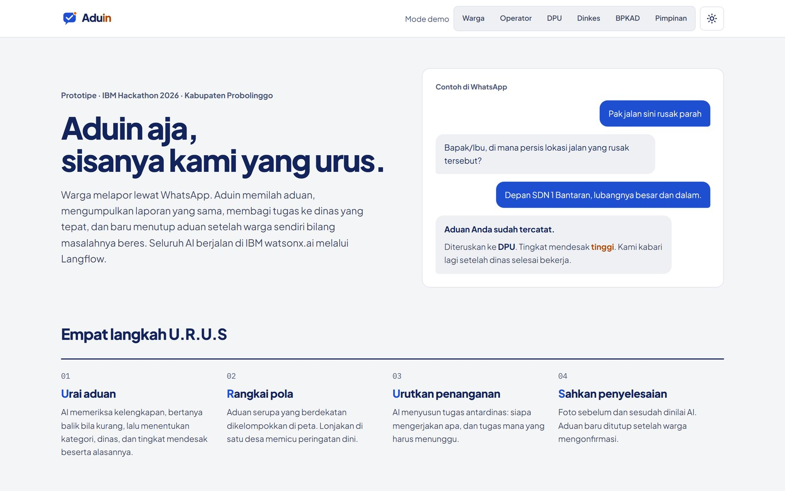
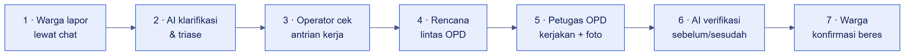

# Selamat datang di Aduin

> **Aduin aja, sisanya kami yang urus.**

Aduin dipasang **di atas** kanal pengaduan yang sudah ada, misalnya layanan aduan WhatsApp milik pemda. Warga tetap mengadu lewat chat. Aduin yang membaca, memilah, mengoordinasikan, dan memastikan masalahnya benar-benar beres.

<figure><figcaption>
Beranda Aduin dengan contoh percakapan warga dan bot.
</figcaption></figure>


Aduin adalah prototipe untuk **IBM Hackathon 2026** dengan studi kasus Kabupaten Probolinggo. Semua AI berjalan lewat **Langflow** dengan model di **IBM watsonx.ai**.


## Mulai dari mana?

<table data-view="cards"><thead><tr><th></th><th></th><th data-hidden data-card-target data-type="content-ref"></th><th data-hidden data-card-cover data-type="files"></th></tr></thead><tbody>
<tr><td><strong>Apa itu Aduin?</strong></td><td>Masalah yang diselesaikan dan cara kerjanya.</td><td><a href="mulai/apa-itu-aduin.md">apa-itu-aduin.md</a></td><td><a href=".gitbook/assets/lapor-klarifikasi.jpg">lapor-klarifikasi.jpg</a></td></tr>
<tr><td><strong>Instalasi cepat</strong></td><td>Jalankan Aduin di komputer sendiri dalam beberapa langkah.</td><td><a href="mulai/instalasi.md">instalasi.md</a></td><td><a href=".gitbook/assets/antrian-kerja.jpg">antrian-kerja.jpg</a></td></tr>
<tr><td><strong>Fitur</strong></td><td>Delapan fitur dari laporan warga sampai dashboard pimpinan.</td><td><a href="fitur/README.md">README.md</a></td><td><a href=".gitbook/assets/peta-hotspot.jpg">peta-hotspot.jpg</a></td></tr>
<tr><td><strong>Arsitektur</strong></td><td>Next.js, Supabase, Langflow, dan IBM watsonx.ai.</td><td><a href="arsitektur/README.md">README.md</a></td><td><a href=".gitbook/assets/diagram-arsitektur.png">diagram-arsitektur.png</a></td></tr>
</tbody></table>

## Alur singkat

<figure><figcaption>
Satu aduan, dari chat warga sampai dikonfirmasi beres.
</figcaption></figure>

## Prinsip desain

* **AI membantu, manusia memutuskan.** Setiap keputusan AI disertai alasan dan bisa dikoreksi operator.
* **Selesai berarti beres.** Aduan baru ditutup setelah foto bukti lolos verifikasi dan warga mengonfirmasi.
* **Tahan gagal.** Setiap flow AI punya fallback, sehingga aduan tidak pernah hilang walau Langflow lambat.
* **Mudah dipahami.** UI "Meja Kerja" memakai bahasa sehari-hari, lima tahap kerja yang jelas, serta mode terang dan gelap.

## Lisensi

Dokumentasi ini dilisensikan di bawah [Creative Commons Attribution 4.0 International (CC BY 4.0)](https://creativecommons.org/licenses/by/4.0/deed.id). Kamu boleh menyalin dan mengadaptasinya asal mencantumkan sumber: **Aduin Docs, Tim Aduin**. Kode sumber Aduin sendiri bersifat proprietary dan tidak termasuk dalam lisensi ini.
