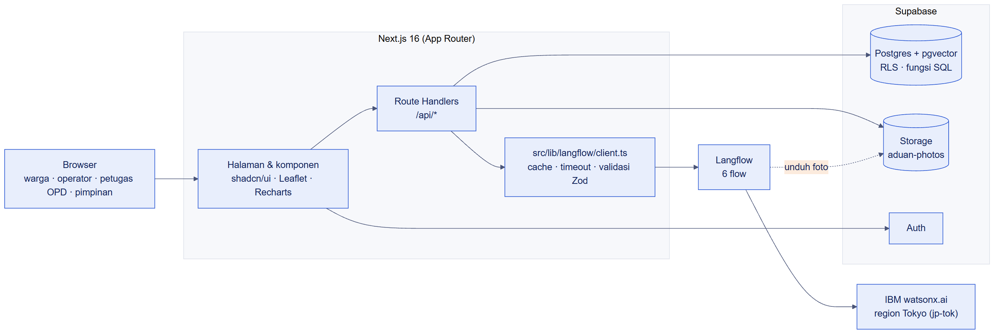

# Gambaran sistem

<figure><figcaption>
Browser → Next.js → Supabase dan Langflow → IBM watsonx.ai.
</figcaption></figure>

## Stack

| Lapisan | Teknologi |
| --- | --- |
| Aplikasi web | Next.js 16 (App Router), TypeScript, Tailwind CSS v4, shadcn/ui |
| Peta dan grafik | Leaflet + OpenStreetMap, Recharts |
| Data | Supabase: Postgres + pgvector, Row Level Security, Storage `aduan-photos`, Auth |
| AI | Langflow 1.12 dengan enam flow, model di IBM watsonx.ai region Tokyo (`jp-tok`) |

## Aturan penting


Aplikasi **tidak pernah** memanggil watsonx.ai langsung, dan tidak ada panggilan AI dari komponen client. Semua lewat `src/lib/langflow/client.ts`.


`client.ts` menjalankan urutan yang sama untuk setiap flow:

1. Cek `ai_cache` dengan key `(flow_name, SHA-256(input))`.
2. Panggil Langflow dengan timeout.
3. Parsing tahan banting: JSON langsung, lalu buang code fence, lalu cari blok `{...}` pertama.
4. Validasi dengan skema Zod. Hasil yang valid disimpan ke cache.

## Fallback per flow

| Kondisi | Yang terjadi |
| --- | --- |
| Triase gagal / timeout / Zod invalid | Status `triage_failed`, aduan masuk tahap "Perlu dicek manusia" |
| `aduin-verify` gagal | Hasil `needs_review`, operator meninjau manual |
| `aduin-alert-summary` gagal | Alert tetap dibuat dengan `pending_retry`, tombol **Coba Lagi** muncul |
| `aduin-opd-agent` gagal | Pesan error di UI, rencana sederhana tetap aktif |

Hasil AI untuk data seed disimpan di `supabase/seed/ai-cache-snapshot.json`, sehingga demo tetap jalan walau Langflow lambat.
