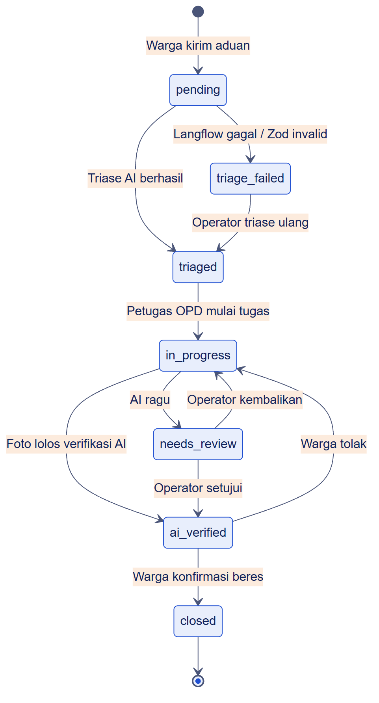

# Status aduan

<figure><figcaption>
Status <code>closed</code> hanya bisa dicapai dari <code>ai_verified</code>.
</figcaption></figure>

| Transisi | Pemicu | Catatan |
| --- | --- | --- |
| `pending` → `triaged` | Sistem | Setelah triase berhasil, rencana sederhana dibuat otomatis |
| `pending` → `triage_failed` | Sistem | Langflow error, timeout, atau keluaran tidak lolos Zod |
| `triage_failed` → `triaged` | Operator | Triase ulang manual, rencana sederhana dibuat ulang |
| `triaged` → `in_progress` | Petugas OPD | Mulai mengerjakan sub-tugas |
| `in_progress` → `ai_verified` | Sistem | Setelah foto bukti diunggah dan AI yakin |
| `in_progress` → `needs_review` | Sistem | Setelah foto bukti diunggah dan AI ragu |
| `needs_review` → `ai_verified` | Operator | Persetujuan manual, dicatat sebagai `manual_approval` |
| `needs_review` → `in_progress` | Operator | Dikembalikan dengan catatan alasan |
| `ai_verified` → `closed` | Warga | Konfirmasi sudah beres |
| `ai_verified` → `in_progress` | Warga | Tolak dengan catatan alasan |

## Hubungan dengan lima tahap UI

| Tahap di antrian kerja | Status |
| --- | --- |
| 1 · Perlu dicek manusia | `triage_failed`, `needs_review` |
| 2 · Siap dikoordinasi | `triaged` |
| 3 · Dikerjakan dinas | `in_progress` |
| 4 · Tunggu konfirmasi warga | `ai_verified` |
| 5 · Selesai | `closed` |
