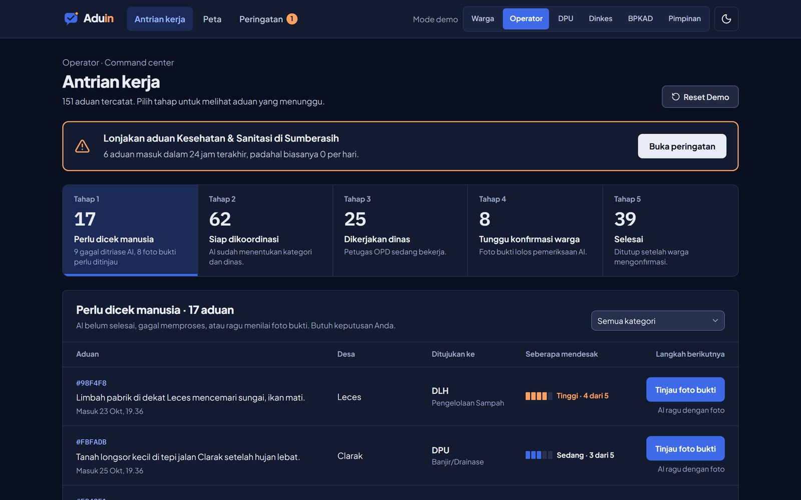

# Ringkasan fitur

<table data-view="cards"><thead><tr><th></th><th></th><th data-hidden data-card-target data-type="content-ref"></th><th data-hidden data-card-cover data-type="files"></th></tr></thead><tbody>
<tr><td><strong>Lapor lewat chat</strong></td><td>Bot bertanya balik kalau laporan kurang lengkap.</td><td><a href="lapor.md">lapor.md</a></td><td><a href="../.gitbook/assets/lapor-klarifikasi.jpg">lapor-klarifikasi.jpg</a></td></tr>
<tr><td><strong>Triase AI</strong></td><td>Kategori, dinas, urgensi, dan alasannya dalam detik.</td><td><a href="triase.md">triase.md</a></td><td><a href="../.gitbook/assets/lapor-terkirim.jpg">lapor-terkirim.jpg</a></td></tr>
<tr><td><strong>Antrian kerja</strong></td><td>Satu antrian, lima tahap, langkah berikutnya selalu jelas.</td><td><a href="antrian-kerja.md">antrian-kerja.md</a></td><td><a href="../.gitbook/assets/antrian-kerja.jpg">antrian-kerja.jpg</a></td></tr>
<tr><td><strong>Rencana koordinasi</strong></td><td>Tugas lintas OPD lengkap dengan ketergantungannya.</td><td><a href="koordinasi.md">koordinasi.md</a></td><td><a href="../.gitbook/assets/rencana-koordinasi.jpg">rencana-koordinasi.jpg</a></td></tr>
<tr><td><strong>Verifikasi foto</strong></td><td>AI membandingkan foto sebelum dan sesudah.</td><td><a href="verifikasi.md">verifikasi.md</a></td><td><a href="../.gitbook/assets/verifikasi-foto.jpg">verifikasi-foto.jpg</a></td></tr>
<tr><td><strong>Peta hotspot</strong></td><td>Aduan serupa yang berdekatan jadi satu klaster.</td><td><a href="peta.md">peta.md</a></td><td><a href="../.gitbook/assets/peta-hotspot.jpg">peta-hotspot.jpg</a></td></tr>
<tr><td><strong>Peringatan dini</strong></td><td>Lonjakan aduan terdeteksi sebelum viral.</td><td><a href="peringatan-dini.md">peringatan-dini.md</a></td><td><a href="../.gitbook/assets/peringatan-dini.jpg">peringatan-dini.jpg</a></td></tr>
<tr><td><strong>Ringkasan pimpinan</strong></td><td>KPI, tren, dan sebaran per kecamatan.</td><td><a href="ringkasan.md">ringkasan.md</a></td><td><a href="../.gitbook/assets/ringkasan-pimpinan.jpg">ringkasan-pimpinan.jpg</a></td></tr>
</tbody></table>

## Mode terang dan gelap

Seluruh tampilan "Meja Kerja" tersedia dalam mode terang dan gelap. Ganti lewat tombol tema di pojok kanan header.

<figure><figcaption>
Antrian kerja operator dalam mode gelap.
</figcaption></figure>
