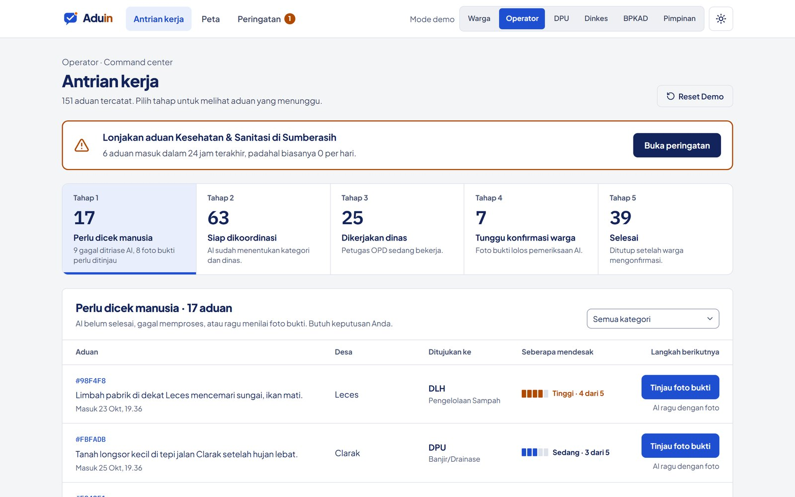

# Antrian kerja operator

**Halaman:** `/dashboard` · **Peran:** Operator

Semua aduan dikumpulkan di satu antrian. Pilih tab tahap untuk melihat aduan yang menunggu di tahap itu (`?tahap=1` sampai `?tahap=5`).

<figure><figcaption>
Banner peringatan dini, lima tab tahap, dan tabel aduan dengan kolom "Langkah berikutnya".
</figcaption></figure>

## Lima tahap

| Tahap | Nama | Isi |
| --- | --- | --- |
| 1 | Perlu dicek manusia | Gagal ditriase AI, atau foto bukti diragukan AI. Butuh keputusan operator. |
| 2 | Siap dikoordinasi | AI sudah menentukan kategori dan dinas. |
| 3 | Dikerjakan dinas | Petugas OPD sedang bekerja. |
| 4 | Tunggu konfirmasi warga | Foto bukti lolos pemeriksaan AI. |
| 5 | Selesai | Ditutup setelah warga mengonfirmasi. |

Kolom **Langkah berikutnya** memberi tombol aksi yang sesuai tahap, misalnya **Tinjau foto bukti** untuk aduan yang perlu dicek.


Kalau ada lonjakan aduan, banner oranye muncul di atas antrian dengan tombol **Buka peringatan**. Lihat [Peringatan dini](peringatan-dini.md).

