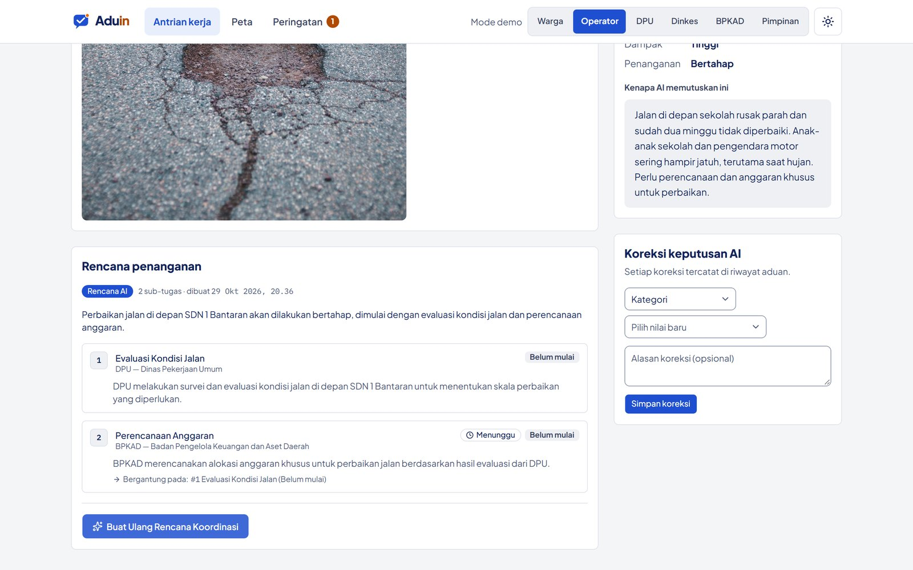
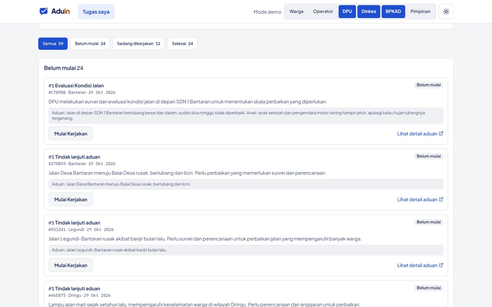

# Rencana koordinasi OPD

**Halaman:** `/aduan/[id]` · **Peran:** Operator · **Flow AI:** `aduin-opd-agent`

Setelah triase berhasil, sistem otomatis membuat **Rencana Sederhana**: satu tugas untuk OPD tujuan. Petugas langsung bisa bekerja tanpa menunggu operator.

Untuk masalah yang butuh beberapa dinas, operator menekan **Buat Rencana Koordinasi**. AI menyusun sub-tugas berurutan dan menggantikan rencana sederhana secara atomik.

<figure><figcaption>
DPU mengevaluasi kondisi jalan lebih dulu. BPKAD menyusun anggaran setelah tugas DPU selesai.
</figcaption></figure>

## Aturan ketergantungan

* Tugas yang bergantung baru bisa dimulai setelah semua tugas yang ditunggunya selesai.
* Rencana tidak bisa diganti lagi setelah petugas OPD mulai mengerjakan tugas.
* Kalau `aduin-opd-agent` gagal, pesan error tampil di UI dan rencana sederhana tetap aktif.

## Dari sisi petugas OPD

Petugas melihat tugasnya di `/tugas`, dikelompokkan per status: **Belum mulai**, **Sedang dikerjakan**, **Selesai**. Tombol **Mulai Kerjakan** dan **Tandai Selesai** memperbarui status tugas.

<figure><figcaption>
Daftar tugas untuk petugas DPU.
</figcaption></figure>
