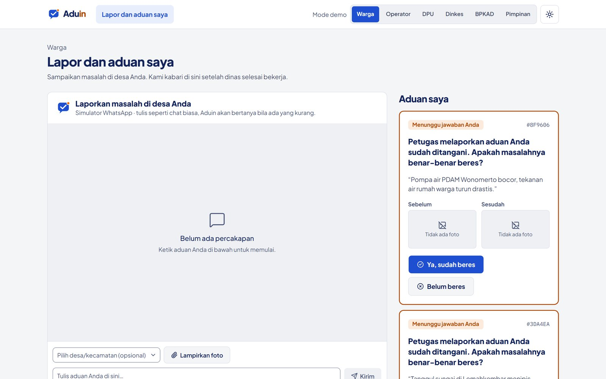
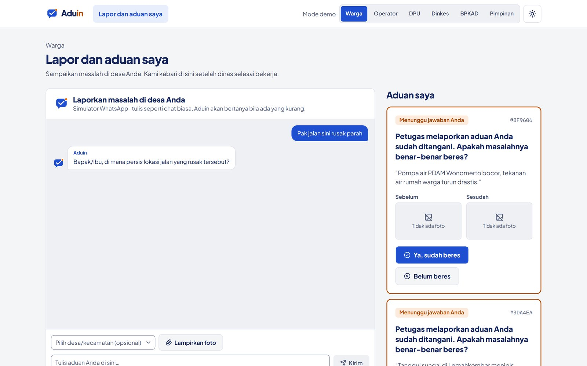
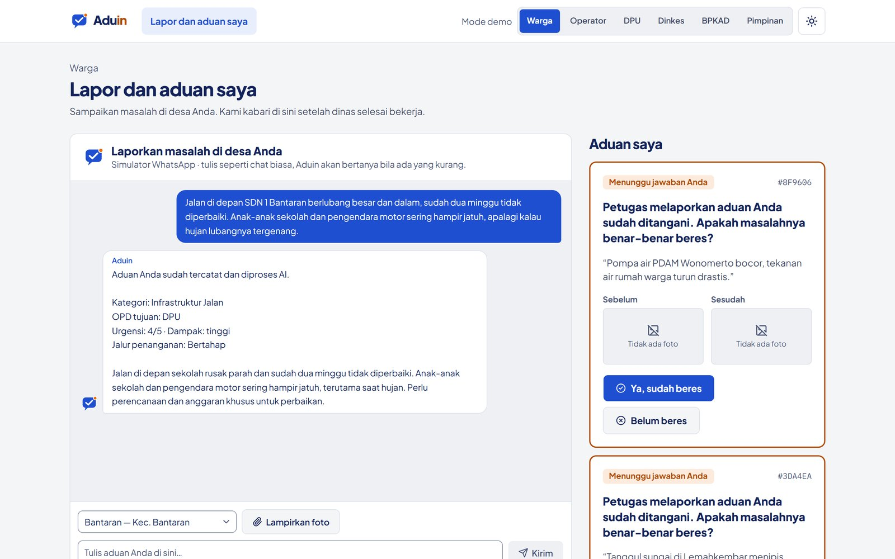

# Lapor lewat chat

**Halaman:** `/lapor` · **Peran:** Warga · **Flow AI:** `aduin-clarify`

Di prototipe ini, kanal WhatsApp disimulasikan sebagai jendela chat. Warga cukup menulis keluhannya, boleh dengan bahasa Indonesia informal, Jawa, atau Madura.



### Tulis aduan

Warga mengetik keluhan. Lokasi (desa atau kecamatan) dan foto bersifat opsional.

<figure><figcaption>
Halaman lapor dan daftar "Aduan saya" di sebelah kanan.
</figcaption></figure>



### Bot bertanya balik

Flow `aduin-clarify` menilai kelengkapan aduan. Kalau lokasi atau masalahnya belum jelas, bot mengajukan **satu** pertanyaan balik.

<figure><figcaption>
"Pak jalan sini rusak parah" belum menyebut lokasi, jadi bot bertanya di mana persisnya.
</figcaption></figure>



### Aduan tercatat

Setelah lengkap, aduan disimpan dan langsung [ditriase](triase.md). Warga melihat ringkasan: kategori, dinas tujuan, dan tingkat mendesak.

<figure><figcaption>
Balasan bot setelah aduan tercatat dan diproses AI.
</figcaption></figure>



## Konfirmasi penyelesaian

Kartu di kolom **Aduan saya** menampilkan aduan yang menunggu jawaban warga. Setelah petugas mengunggah bukti dan AI memverifikasinya, warga memilih **Ya, sudah beres** atau **Belum beres**. Aduan hanya bisa ditutup dari sini.
