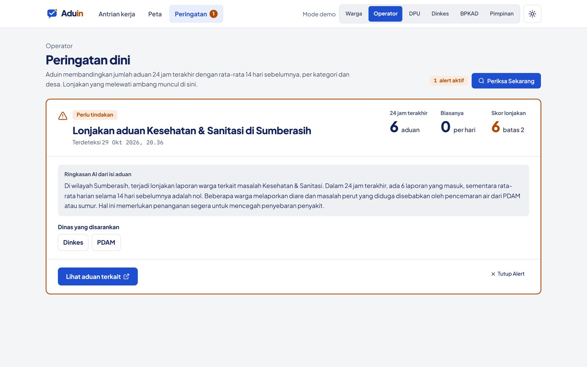

# Peringatan dini

**Halaman:** `/alert` · **Peran:** Operator, Pimpinan · **Flow AI:** `aduin-alert-summary`

Aduin membandingkan jumlah aduan 24 jam terakhir dengan rata-rata 14 hari sebelumnya, per kategori dan desa. Lonjakan yang melewati ambang muncul di halaman ini dan sebagai banner di antrian kerja.

<figure><figcaption><p>6 aduan Kesehatan &#x26; Sanitasi di Sumberasih dalam 24 jam, padahal biasanya 0 per hari.</p></figcaption></figure>

## Kapan alert muncul?

```
z = (jumlah_24_jam − rata_rata_14_hari) / simpangan_baku_14_hari
```

Alert terpicu jika **z ≥ 2,0** dan minimal **3 aduan** dalam 24 jam.

## Isi kartu alert

* Angka **24 jam terakhir**, **Biasanya**, dan **Skor lonjakan** beserta batasnya.
* **Ringkasan AI dari isi aduan**, misalnya dugaan penyebab.
* **Dinas yang disarankan** untuk menangani.
* Tombol **Lihat aduan terkait** dan **Tutup Alert**.


Kalau ringkasan AI gagal dibuat, alert tetap tampil dengan tombol **Coba Lagi**. Tombol **Periksa Sekarang** menjalankan pengecekan untuk semua kombinasi kategori dan desa.

