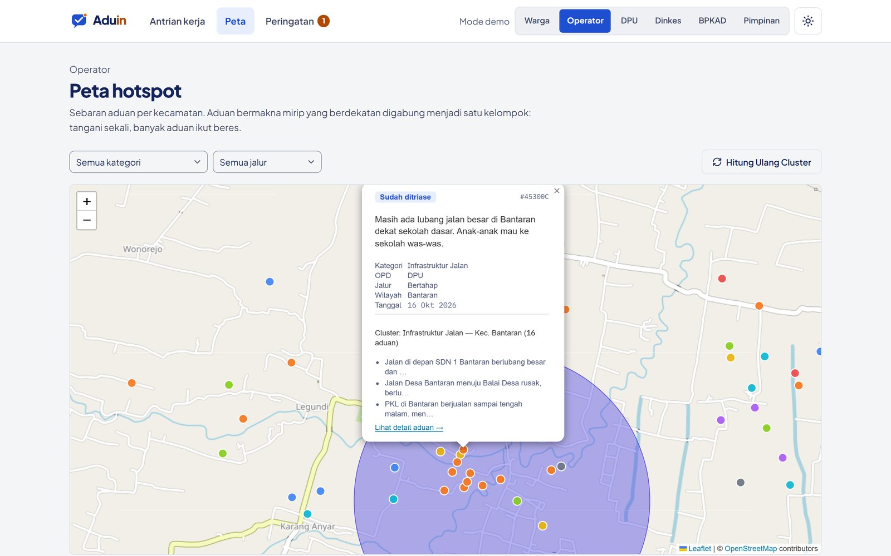

# Peta hotspot

**Halaman:** `/peta` · **Peran:** Operator · **Flow AI:** `aduin-embed`

Setiap aduan diubah menjadi embedding 768 dimensi dengan `ibm/granite-embedding-278m-multilingual`, lalu dikelompokkan. Peta Leaflet + OpenStreetMap menampilkan marker per aduan, lingkaran klaster, dan intensitas per kecamatan.

<figure><figcaption>
Popup aduan menunjukkan klaster "Infrastruktur Jalan — Kec. Bantaran" berisi 16 aduan.
</figcaption></figure>

## Kapan dua aduan satu klaster?

Ketiga syarat harus terpenuhi sekaligus:

1. Cosine similarity embedding **≥ 0,75**
2. Jarak **≤ 500 m**
3. Selisih waktu lapor **≤ 14 hari**

Filter di atas peta menyaring per kategori dan jalur penanganan. Tombol **Hitung Ulang Cluster** menjalankan ulang clustering. Detail algoritmanya ada di [Clustering dan early warning](../arsitektur/algoritma.md).
