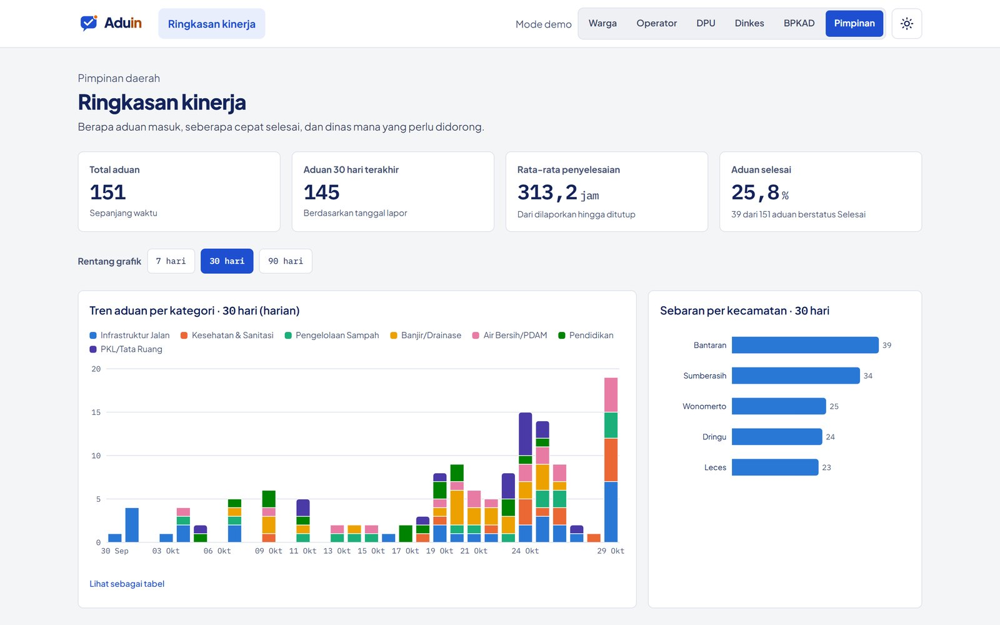

# Ringkasan pimpinan

**Halaman:** `/ringkasan` · **Peran:** Pimpinan

Pimpinan mendapat gambaran kinerja daerah dalam satu halaman, tanpa perlu membuka aduan satu per satu.

<figure><figcaption>
KPI, tren aduan per kategori, dan sebaran per kecamatan.
</figcaption></figure>

## Isi dashboard

| Bagian | Isi |
| --- | --- |
| KPI | Total aduan, aduan 30 hari terakhir, rata-rata waktu penyelesaian, persentase aduan selesai |
| Tren | Aduan per kategori per hari, rentang 7, 30, atau 90 hari |
| Sebaran | Jumlah aduan per kecamatan |
| Peringkat OPD | Kinerja tiap dinas dalam menyelesaikan aduan |

Setiap grafik punya tautan **Lihat sebagai tabel** agar datanya tetap bisa dibaca tanpa grafik.
