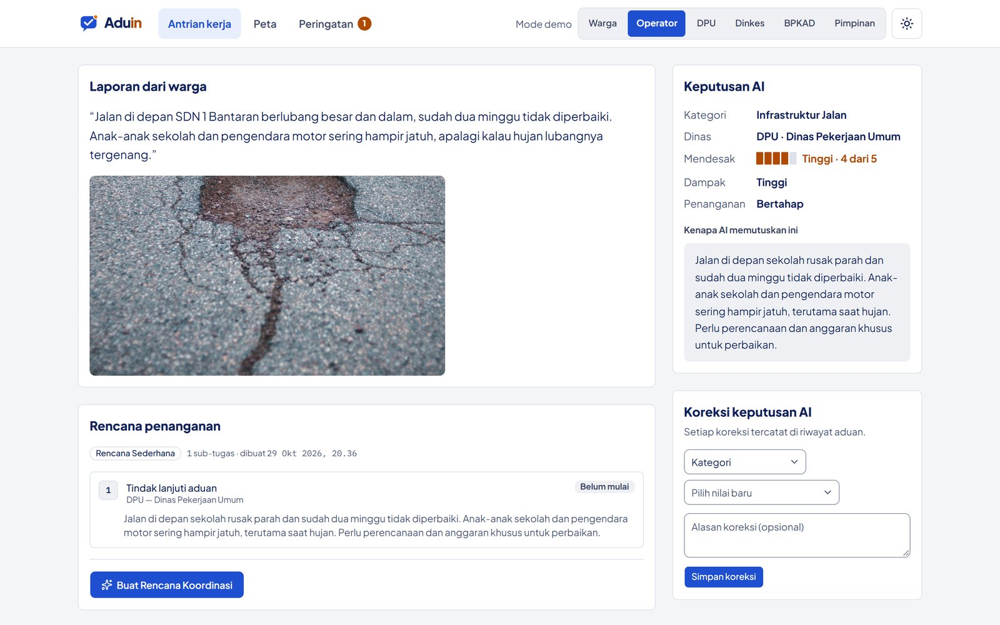
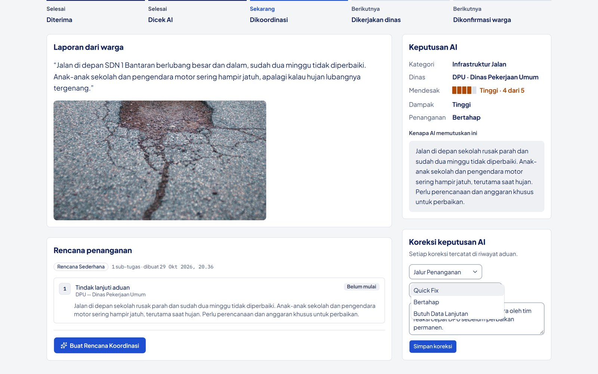

# Triase AI

**Halaman:** `/aduan/[id]` · **Peran:** Operator · **Flow AI:** `aduin-triage`

Begitu aduan masuk, flow `aduin-triage` mengembalikan enam keputusan:

| Keluaran | Nilai |
| --- | --- |
| Kategori | Salah satu dari 7 kategori baku, mis. `infrastruktur_jalan` |
| OPD tujuan | DPU, Dinkes, DLH, PDAM, Disdik, atau Satpol |
| Urgensi | 1–5 |
| Dampak | rendah, sedang, tinggi |
| Jalur penanganan | `quick_fix`, `bertahap`, `butuh_data` |
| Alasan | Penjelasan singkat dalam Bahasa Indonesia |

<figure><figcaption>
Kartu "Keputusan AI" beserta bagian "Kenapa AI memutuskan ini".
</figcaption></figure>

## Koreksi oleh petugas

Operator bisa mengoreksi bagian mana pun lewat kartu **Koreksi keputusan AI**: pilih bagian yang dikoreksi, nilai baru, dan alasan (opsional), lalu **Simpan koreksi**. Setiap koreksi tercatat di riwayat aduan, dan nilai efektif aduan ikut diperbarui.

<figure><figcaption>
Mengoreksi jalur penanganan dari "Bertahap" ke "Quick Fix".
</figcaption></figure>


Kalau Langflow gagal, timeout, atau keluarannya tidak lolos validasi Zod, aduan masuk status `triage_failed` dan tampil di tahap **Perlu dicek manusia**. Aduan tidak pernah hilang.


## Akurasi

Pada 30 aduan held-out, akurasi kategori **90%** (96% tanpa kasus ambigu). Rinciannya di [Evaluasi triase](../referensi/evaluasi.md).
