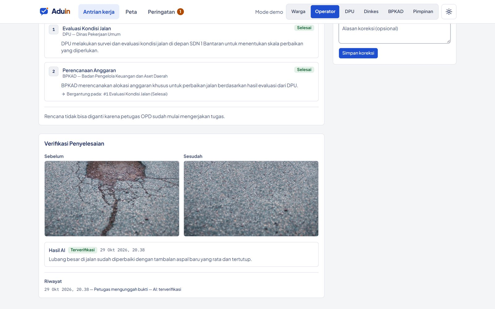

# Verifikasi foto

**Halaman:** `/tugas`, `/aduan/[id]` · **Peran:** Petugas OPD, Operator, Warga · **Flow AI:** `aduin-verify`

Setelah semua tugas selesai, petugas mengunggah **foto bukti penyelesaian**. Model vision membandingkannya dengan foto dari warga.

<figure><figcaption>
Foto sebelum dan sesudah, dengan hasil AI "Terverifikasi".
</figcaption></figure>

## Hasil yang mungkin

| Hasil AI | Artinya | Langkah berikutnya |
| --- | --- | --- |
| **Terverifikasi** (`ai_verified`) | Masalah terlihat sudah diperbaiki | Warga diminta konfirmasi |
| **Perlu ditinjau** (`needs_review`) | AI ragu, atau verifikasi gagal | Operator menyetujui atau mengembalikan dengan catatan |

## Konfirmasi warga

Aduan baru berstatus **Selesai** setelah warga memilih **Ya, sudah beres**. Kalau warga memilih **Belum beres**, aduan kembali ke tahap dikerjakan dinas.


Dengan dua lapis pemeriksaan ini, AI lalu warga, status "selesai" di Aduin benar-benar bisa dipercaya.

