# Proposal Aduin — Platform Analitik AI untuk Layanan Pengaduan Masyarakat

[TANGGAL] · [NAMA PENGIRIM]

## Ringkasan

Aduin adalah aplikasi web yang menambahkan lapisan analitik AI di atas kanal pengaduan masyarakat yang sudah dimiliki pemerintah daerah, misalnya hotline WhatsApp. Aduin memilah aduan secara otomatis, mengelompokkan aduan serupa, menyusun koordinasi lintas dinas, memverifikasi penyelesaian dengan foto, dan memberi peringatan dini ke pimpinan saat aduan serupa melonjak di satu wilayah.

Aduin saat ini berstatus **prototipe fungsional** yang sudah diuji ujung ke ujung dengan data demo, dikembangkan untuk IBM Hackathon 2026. Melalui dokumen ini kami menawarkan [MODEL KERJA SAMA: pengalihan penuh / lisensi / implementasi] kepada [NAMA CALON MITRA].

| Ringkasan | Keterangan |
| --- | --- |
| Produk | Aplikasi web Aduin beserta 6 alur AI di IBM Langflow |
| Pengguna | Warga, operator command center, petugas OPD, pimpinan daerah |
| Teknologi | Next.js, Supabase, IBM Langflow, IBM watsonx.ai |
| Status | Prototipe fungsional, seluruh alur demo teruji |
| Akurasi triage | 90% pada 30 aduan uji yang tidak dipakai saat pengembangan |

## Masalah yang diselesaikan

Kanal pengaduan pemerintah daerah umumnya berhenti pada tahap menerima dan meneruskan aduan. Setelah itu, empat celah muncul:

1. **Prioritas bergantung penilaian manual.** Operator memilah aduan satu per satu, sehingga kategori, dinas tujuan, dan urgensi tidak konsisten.
2. **Aduan yang sama tercatat berkali-kali.** Banyak warga melaporkan masalah yang sama, tetapi diperlakukan sebagai tiket terpisah.
3. **Koordinasi lintas dinas dilakukan lewat chat.** Pekerjaan yang saling bergantung, seperti survei lalu anggaran lalu perbaikan, mudah macet.
4. **Tiket ditutup tanpa bukti.** Warga tidak mendapat konfirmasi, dan data penyelesaian tidak bisa dipercaya.

Akibatnya, masalah sistemik seperti lonjakan kasus diare di satu desa baru terlihat setelah meluas, dan pimpinan tidak memiliki data agregat untuk perencanaan.

## Solusi: kerangka U.R.U.S

Aduin dipasang di atas kanal yang sudah ada, sehingga warga tidak perlu mengubah kebiasaan dan pemerintah daerah tidak perlu mengganti sistem. Cara kerjanya mengikuti empat langkah yang diambil dari tagline "Aduin aja, sisanya kami yang **urus**":

| Langkah | Yang dikerjakan Aduin |
| --- | --- |
| **U**rai aduan | AI memeriksa kelengkapan, bertanya balik bila perlu, lalu menentukan kategori, OPD tujuan, urgensi, dampak, jalur penanganan, dan alasannya |
| **R**angkai pola | Aduan serupa yang berdekatan digabung menjadi cluster di peta; lonjakan di satu wilayah memicu peringatan dini |
| **U**rutkan penanganan | AI agent menyusun sub-tugas lintas OPD beserta urutan dan ketergantungannya |
| **S**ahkan penyelesaian | Foto sebelum dan sesudah dinilai AI, lalu warga mengonfirmasi sebelum tiket ditutup |

Setiap keputusan AI disertai alasan tertulis dan dapat dikoreksi operator. Keputusan yang berdampak, seperti rencana lintas dinas dan penutupan tiket, tetap disetujui manusia.

## Daftar fitur

Aduin terdiri dari 10 modul yang dipakai oleh empat peran. Kolom terakhir merujuk ke nomor screenshot di bagian Galeri Fitur.

| Modul | Fitur | Peran | Screenshot |
| --- | --- | --- | --- |
| Intake aduan | Simulator WhatsApp: teks, foto, dan pilihan lokasi desa/kecamatan; daftar "Aduan Saya" beserta statusnya | Warga | 02, 03 |
| Klarifikasi AI | Bot bertanya balik bila lokasi atau detail aduan kurang, sebelum aduan disimpan | Warga | 02 |
| Triage AI explainable | Kategori, OPD tujuan, urgensi 1–5, dampak, jalur penanganan (quick fix / bertahap / butuh data), dan alasan tertulis; memahami bahasa Indonesia informal, Jawa, dan Madura | Operator | 05 |
| Override dan audit | Operator dapat mengubah kategori, OPD, atau jalur hasil AI; setiap perubahan tercatat | Operator | 06 |
| Clustering dan peta hotspot | Aduan serupa (kemiripan makna, jarak ≤ 500 m, rentang 14 hari) digabung; peta per kecamatan dengan filter kategori dan jalur | Operator | 08 |
| Koordinasi lintas OPD | AI agent menyusun sub-tugas per dinas dengan urutan dan ketergantungan; rencana dapat ditinjau sebelum dijalankan | Operator, petugas OPD | 07, 10 |
| Portal tugas OPD | Daftar tugas per dinas; tugas yang menunggu tugas lain ditandai dan belum bisa dimulai | Petugas OPD | 10 |
| Verifikasi penyelesaian | Unggah foto bukti; AI membandingkan foto sebelum dan sesudah; tinjauan manual bila AI ragu; warga mengonfirmasi atau menolak | Petugas OPD, operator, warga | 11, 12 |
| Peringatan dini | Deteksi lonjakan per kategori dan wilayah (z-score 24 jam vs baseline 14 hari) dengan ringkasan AI dan rekomendasi OPD | Operator, pimpinan | 09 |
| Dashboard pimpinan | KPI (total aduan, rata-rata waktu selesai, persentase selesai), tren per kategori, sebaran per kecamatan, peringkat kinerja OPD | Pimpinan | 13 |

Fitur pendukung: login per peran dengan keamanan data tingkat baris (RLS), mode terang dan gelap (screenshot 14), tampilan responsif hingga lebar 390 px, mode demo dengan tombol reset data, dan landing page (screenshot 01).

## Arsitektur dan teknologi

Aplikasi Aduin menyimpan data di Supabase dan memanggil enam flow IBM Langflow lewat REST API; flow tersebut menjalankan model di IBM watsonx.ai.

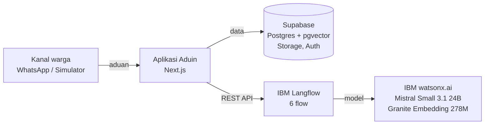

Karena setiap flow punya kontrak input dan output yang tetap, prompt di Langflow bisa diperbaiki tanpa mengubah kode aplikasi.

| Lapisan | Teknologi |
| --- | --- |
| Aplikasi | Next.js (App Router), TypeScript, Tailwind, shadcn/ui |
| Data | Supabase: Postgres, pgvector, Storage, Auth, keamanan tingkat baris |
| Alur AI | IBM Langflow, 6 flow termasuk 2 komponen kustom Python |
| Model | IBM watsonx.ai: Mistral Small 3.1 24B Instruct, IBM Granite Embedding 278M Multilingual |
| Peta dan grafik | Leaflet dengan OpenStreetMap, Recharts |
| Alat pengembangan | IBM Bob untuk perancangan dan fondasi, Claude Code untuk implementasi lanjutan |

## Hasil uji dan status kesiapan

Triage AI mencapai akurasi 90% pada 30 aduan uji yang tidak dipakai selama pengembangan. Seluruh alur demo, dari laporan warga sampai tiket ditutup, berjalan ujung ke ujung.

| Pengujian | Hasil |
| --- | --- |
| Akurasi kategori triage (aduan uji baru) | 90% (27 dari 30) |
| Akurasi tanpa kasus yang sengaja dibuat ambigu | 96% (24 dari 25) |
| Aduan berbahasa Jawa dan Madura | 14 dari 14 benar |
| Waktu triage per aduan | 3–6 detik |
| Verifikasi foto | Tambalan aspal dikenali sebagai selesai; pasangan foto yang ditukar ditolak |
| Peringatan dini | Lonjakan aduan diare simulasi terdeteksi dan diringkas AI |

**Keterbatasan saat ini** (perlu dikerjakan sebelum dipakai di lingkungan produksi):

- Kanal WhatsApp masih berupa simulator di dalam aplikasi, belum tersambung ke WhatsApp Business API.
- Data demo bersifat sintetis dan dikonfigurasi untuk lima kecamatan di Kabupaten Probolinggo.
- Langflow berjalan di server lokal; perlu dipindah ke server yang dapat diakses aplikasi produksi.
- Model watsonx.ai yang dipakai bergantung pada ketersediaan di region akun (saat ini Tokyo).
- Belum ada uji beban, uji keamanan independen, maupun integrasi dengan SP4N-LAPOR!.
- Akurasi diukur pada set uji kecil; perlu evaluasi ulang dengan aduan nyata dari daerah mitra.

## Galeri fitur

Semua screenshot diambil dari prototipe yang berjalan dengan data demo, berurutan mengikuti satu alur: warga melapor, operator meninjau dan mengoordinasikan, petugas OPD menyelesaikan, lalu warga mengonfirmasi.

### 01 · Landing page

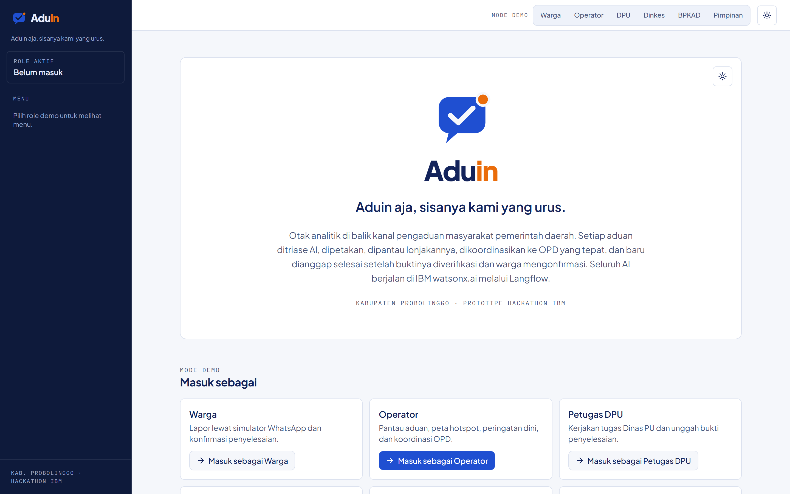

Halaman pembuka memperlihatkan logo, tagline "Aduin aja, sisanya kami yang urus.", dan ringkasan cara kerja Aduin. Di bawahnya tersedia tombol "Masuk sebagai" untuk setiap akun demo (warga, operator, petugas DPU, Dinkes, BPKAD, dan pimpinan), sehingga calon mitra bisa mencoba setiap peran tanpa membuat akun.

### 02 · Klarifikasi otomatis oleh bot

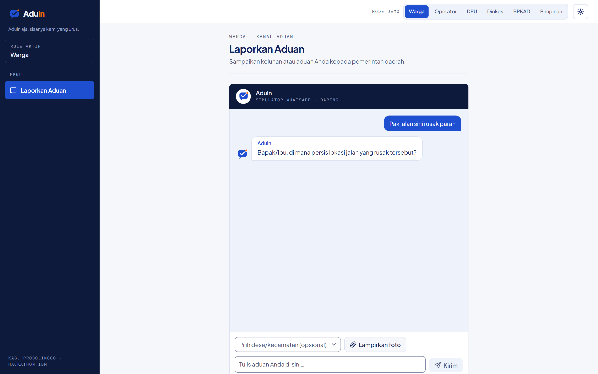

Warga mengirim aduan singkat "Pak jalan sini rusak parah" di simulator WhatsApp tanpa memilih desa. AI menilai aduan belum lengkap dan bot langsung bertanya balik, "Bapak/Ibu, di mana persis lokasi jalan yang rusak tersebut?". Aduan baru disimpan setelah informasinya cukup, sehingga operator tidak menerima laporan yang tidak bisa ditindaklanjuti.

### 03 · Aduan tercatat dan langsung ditriase

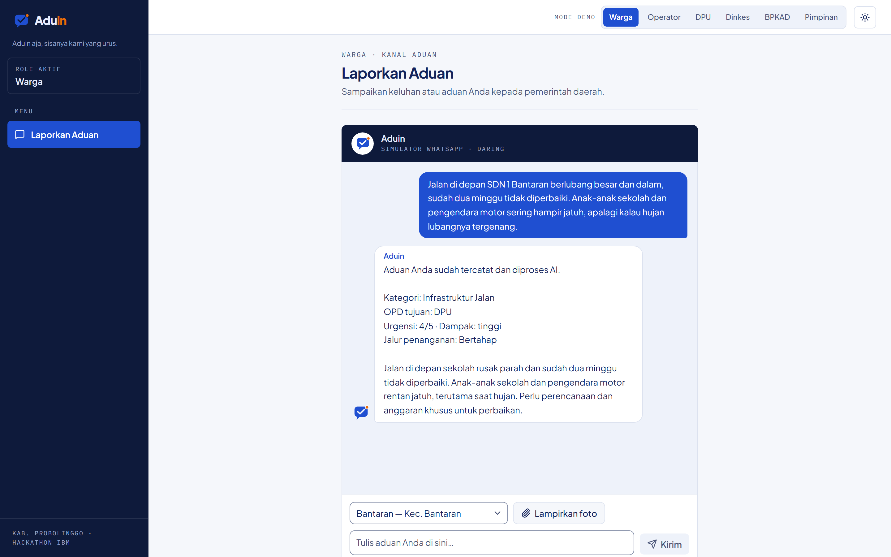

Warga memilih desa Bantaran, melampirkan foto, dan menjelaskan jalan berlubang di depan SDN 1 Bantaran. Dalam satu balasan, bot mengonfirmasi bahwa aduan tercatat beserta hasil AI: kategori Infrastruktur Jalan, OPD tujuan DPU, urgensi 4/5, dampak tinggi, jalur penanganan Bertahap, dan alasannya. Warga langsung tahu aduannya diteruskan ke dinas mana.

### 04 · Daftar aduan untuk operator

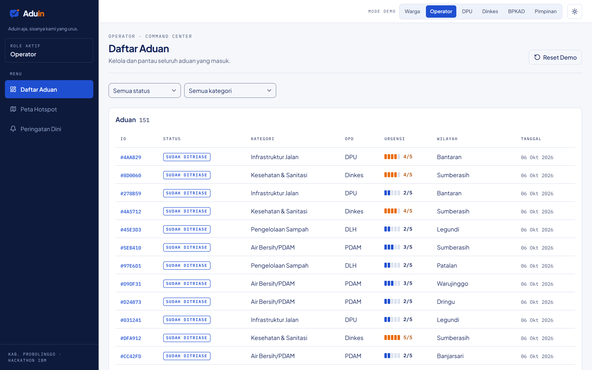

Operator command center melihat seluruh aduan (151 aduan pada data demo) dalam satu tabel berisi ID, status, kategori, OPD, urgensi, wilayah, dan tanggal, dengan filter status dan kategori. Aduan dari langkah 03 muncul paling atas dengan status "Sudah Ditriase", sehingga operator tidak perlu memilah aduan baru secara manual.

### 05 · Detail aduan dan alasan AI

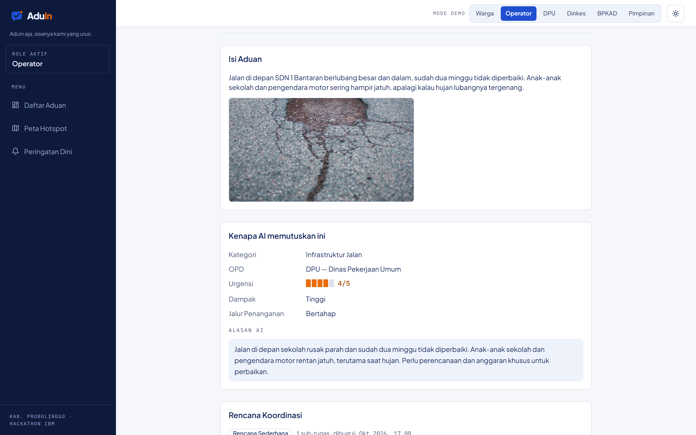

Halaman detail menampilkan isi aduan, foto dari warga, dan kartu "Kenapa AI memutuskan ini" yang memuat kategori, OPD, urgensi, dampak, jalur penanganan, serta alasan AI dalam kalimat biasa. Operator dapat memeriksa dasar keputusan AI sebelum menindaklanjutinya.

### 06 · Override hasil AI oleh operator

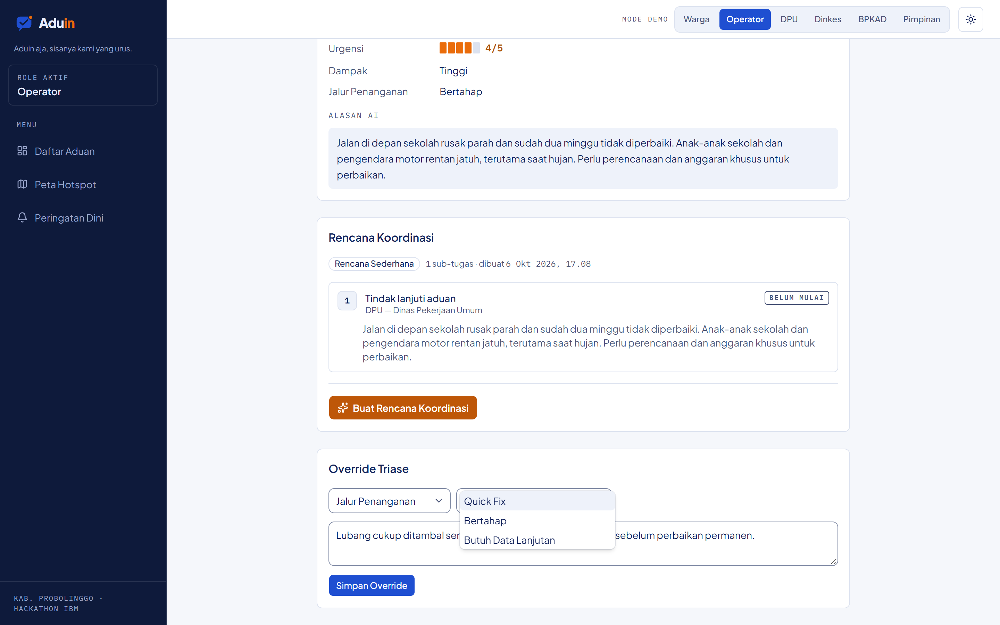

Bila tidak setuju dengan AI, operator membuka form "Override Triase", memilih bagian yang dikoreksi (kategori, OPD, atau jalur penanganan), memilih nilai baru, dan menulis catatan alasan. Contoh di sini menyiapkan perubahan jalur dari Bertahap ke Quick Fix (tidak disimpan). Override yang disimpan tercatat di riwayat aduan, sehingga keputusan akhir tetap di tangan manusia dan dapat diaudit.

### 07 · Rencana koordinasi lintas OPD

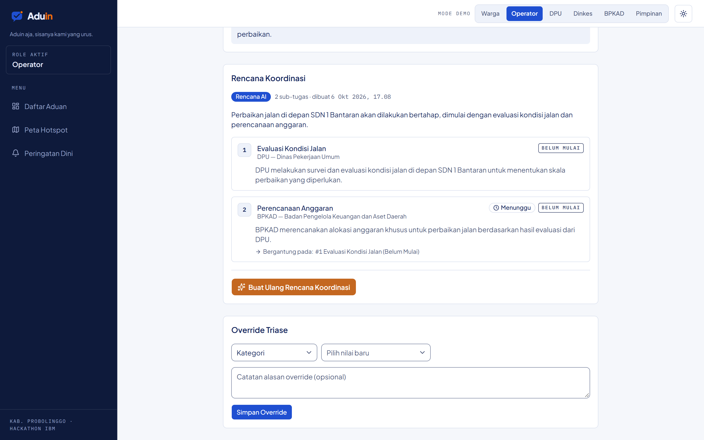

Dengan satu klik "Buat Rencana Koordinasi", AI agent menyusun rencana bertahap untuk aduan jalan ini: DPU mengevaluasi kondisi jalan lebih dulu, lalu BPKAD merencanakan anggaran. Tugas BPKAD otomatis ditandai "Menunggu" karena bergantung pada tugas DPU, sehingga urutan kerja antardinas jelas sejak awal.

### 08 · Peta hotspot dan cluster aduan

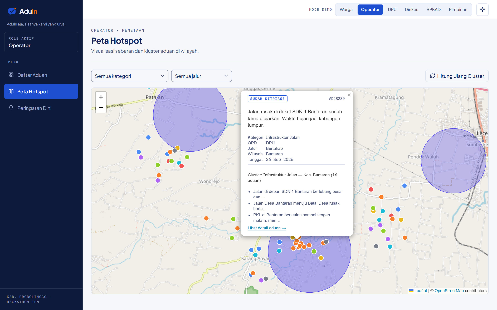

Peta memperlihatkan sebaran aduan per kategori dan lingkaran per kecamatan yang makin pekat seiring jumlah aduan aktif. Popup marker di Bantaran menunjukkan detail aduan serta cluster "Infrastruktur Jalan — Kec. Bantaran" berisi 16 aduan, termasuk aduan baru dari langkah 03. Operator melihat bahwa banyak laporan sebenarnya mengarah ke masalah yang sama di wilayah yang sama.

### 09 · Peringatan dini lonjakan aduan

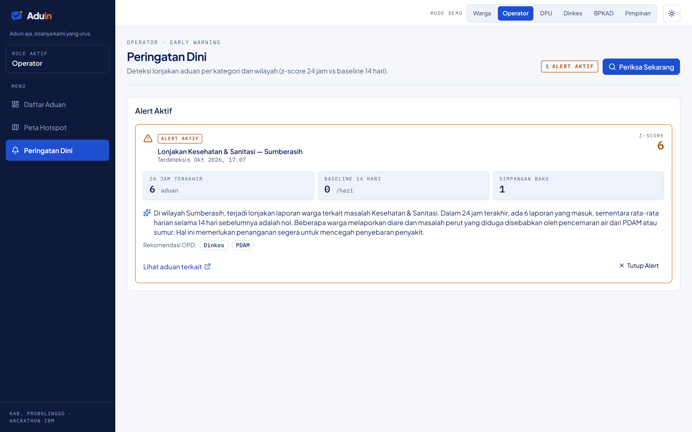

Aduin mendeteksi lonjakan aduan Kesehatan & Sanitasi di Sumberasih: 6 aduan dalam 24 jam terakhir dengan baseline 14 hari sebesar 0 per hari (z-score 6). AI meringkas isi aduan, yaitu keluhan diare yang diduga terkait pencemaran air, dan merekomendasikan Dinkes dan PDAM. Masalah yang berpotensi meluas terlihat lebih awal, sebelum menjadi wabah.

### 10 · Portal tugas petugas OPD

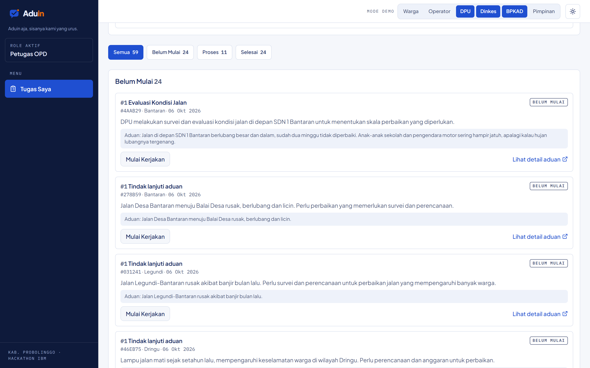

Petugas DPU melihat daftar tugas dinasnya yang dikelompokkan per status (Belum Mulai, Proses, Selesai). Tugas "Evaluasi Kondisi Jalan" dari rencana langkah 07 berada paling atas lengkap dengan isi aduan dan tombol "Mulai Kerjakan". Petugas tidak perlu menunggu instruksi lewat chat.

### 11 · Verifikasi penyelesaian dengan foto

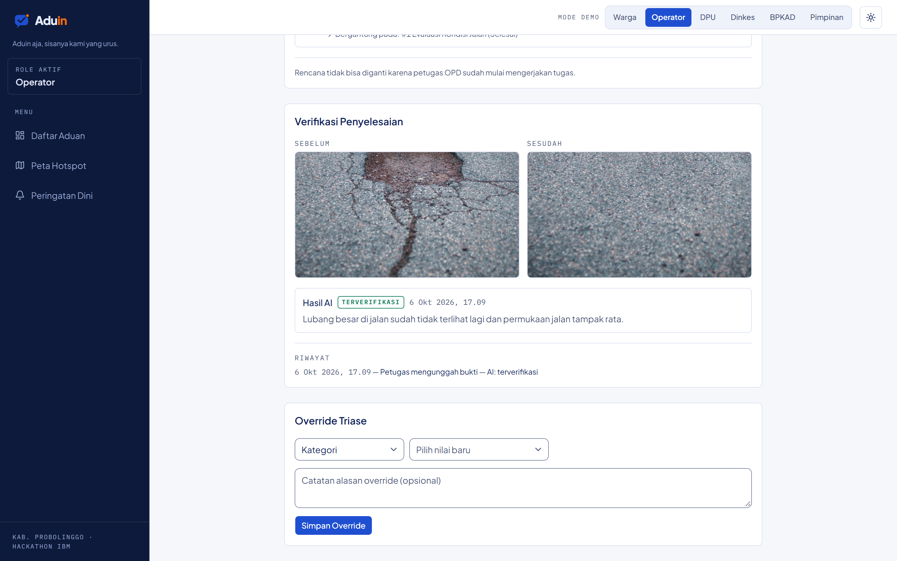

Setelah semua sub-tugas selesai, petugas DPU mengunggah foto bukti. Kartu "Verifikasi Penyelesaian" menampilkan foto sebelum dan sesudah berdampingan, dan AI memberi status "Terverifikasi" dengan alasan "Lubang besar di jalan sudah tidak terlihat lagi dan permukaan jalan tampak rata." Setiap unggahan tercatat di riwayat, sehingga data penyelesaian bisa dipercaya.

*Catatan: data seed tidak memiliki aduan dengan foto sebelum dan sesudah, sehingga screenshot ini memakai aduan dari langkah 03 yang diselesaikan lewat alur demo. Kedua foto adalah foto simulasi.*

### 12 · Konfirmasi oleh warga

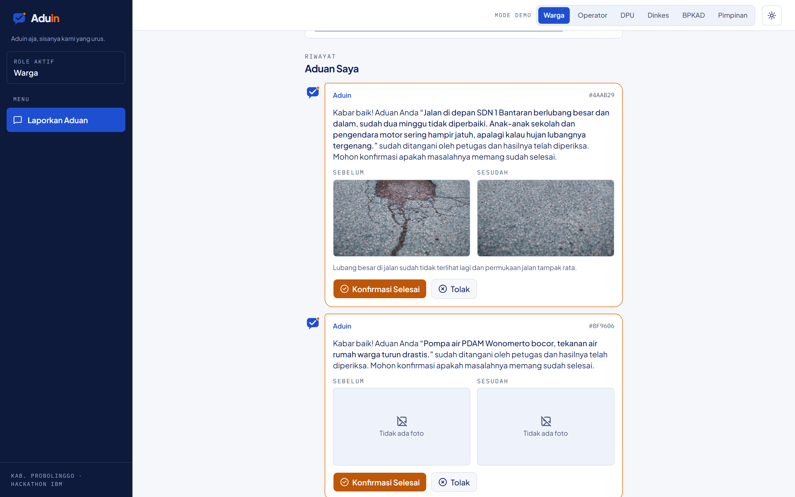

Di bagian "Aduan Saya", bot Aduin memberi tahu warga bahwa aduannya sudah ditangani, lengkap dengan foto sebelum dan sesudah serta hasil pemeriksaan AI. Warga memilih "Konfirmasi Selesai" atau "Tolak". Tiket baru ditutup setelah warga sendiri menyatakan masalahnya beres.

### 13 · Dashboard pimpinan

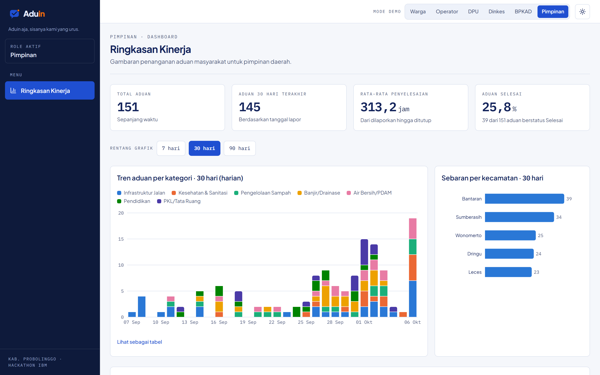

Pimpinan daerah melihat KPI utama: total aduan, aduan 30 hari terakhir, rata-rata waktu penyelesaian, dan persentase aduan selesai. Grafik tren harian per kategori dan sebaran aduan per kecamatan dapat dilihat untuk rentang 7, 30, atau 90 hari. Data ini menjadi dasar perencanaan dan evaluasi kinerja OPD.

### 14 · Mode gelap

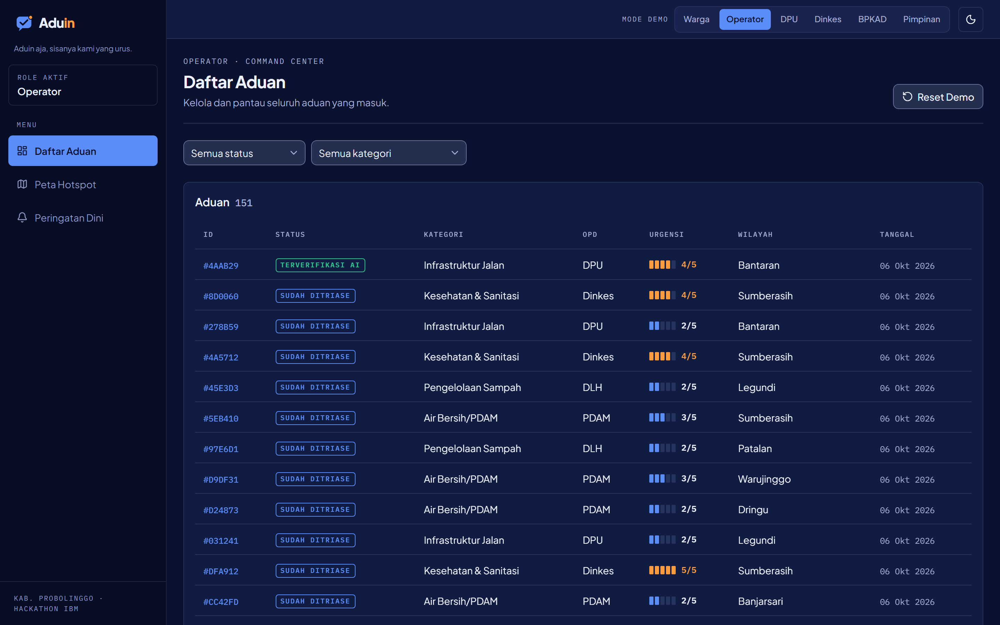

Seluruh tampilan tersedia dalam mode gelap yang dapat dialihkan dengan satu tombol di header, seperti terlihat pada daftar aduan operator ini. Mode ini nyaman untuk layar command center yang menyala sepanjang hari. Aduan dari langkah 03 kini berstatus "Terverifikasi AI".

## Yang diserahkan

| Aset | Isi |
| --- | --- |
| Kode sumber aplikasi | Repositori Next.js lengkap dengan riwayat Git |
| Database | Skrip migrasi Supabase (skema, kebijakan keamanan per peran, fungsi database) |
| Alur AI | 6 flow Langflow dalam format JSON, termasuk 2 komponen kustom Python |
| System prompt | Prompt untuk setiap flow beserta kontrak input dan output |
| Data demo | 150 aduan sintetis, data wilayah, OPD, akun demo, dan snapshot hasil AI |
| Evaluasi | Set uji 30 aduan dan skrip pengukuran akurasi |
| Dokumentasi | PRD, arsitektur, panduan instalasi (README), dan naskah demo |
| Materi presentasi | Pitch deck, logo dalam beberapa versi, dan video demo |
| Pendampingan | [JUMLAH] sesi serah terima teknis selama [DURASI] |

Biaya layanan pihak ketiga (IBM watsonx.ai, Supabase, hosting aplikasi dan Langflow) tidak termasuk dan ditanggung oleh [PIHAK YANG DISEPAKATI].

## Opsi kerja sama

| Opsi | Yang didapat pembeli | Kepemilikan | Harga |
| --- | --- | --- | --- |
| A. Pengalihan penuh | Seluruh aset di bagian "Yang diserahkan" dan hak kekayaan intelektual atas Aduin | Pembeli | Rp [___] |
| B. Lisensi dan implementasi | Hak pakai untuk [JUMLAH] daerah, instalasi di server pembeli, kustomisasi kategori, OPD, dan wilayah | Tim pengembang | Rp [___] + Rp [___] per tahun |
| C. Pengembangan lanjutan | Opsi A atau B ditambah pengerjaan roadmap tahap 1 dan 2 | Sesuai opsi dasar | Rp [___] |

Skema pembayaran: [CONTOH: 50% saat penandatanganan, 50% setelah serah terima]. Masa garansi perbaikan bug: [DURASI].

## Roadmap pengembangan

1. **Siap produksi.** Integrasi WhatsApp Business API, Langflow di server produksi, konfigurasi wilayah dan OPD daerah mitra, uji beban dan uji keamanan, serta evaluasi akurasi dengan aduan nyata.
2. **Integrasi dan jangkauan.** Sambungan ke SP4N-LAPOR!, aduan lewat SMS atau telepon, dan transkripsi voice note berbahasa daerah.
3. **Analitik kebijakan.** Policy brief otomatis untuk pimpinan, masukan prioritas untuk Musrenbang, indeks kepuasan per wilayah, portal open data, dan dukungan multi-daerah dalam satu instalasi.

## Langkah berikutnya

1. Demo langsung aplikasi kepada [NAMA CALON MITRA]
2. Penyepakatan opsi kerja sama dan cakupan
3. Penandatanganan perjanjian dan serah terima aset

**Kontak:** [NAMA] · [EMAIL] · [NOMOR TELEPON]
